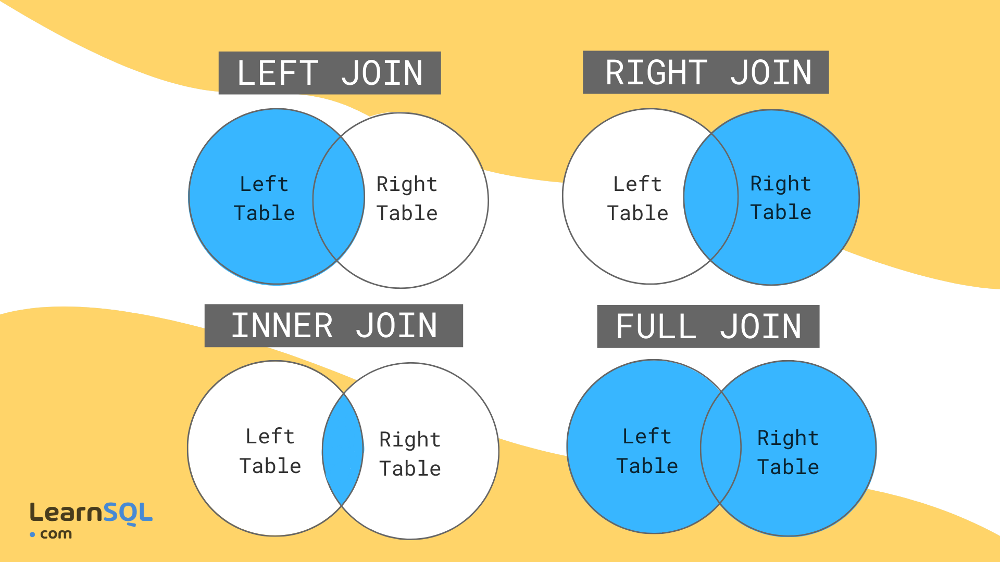
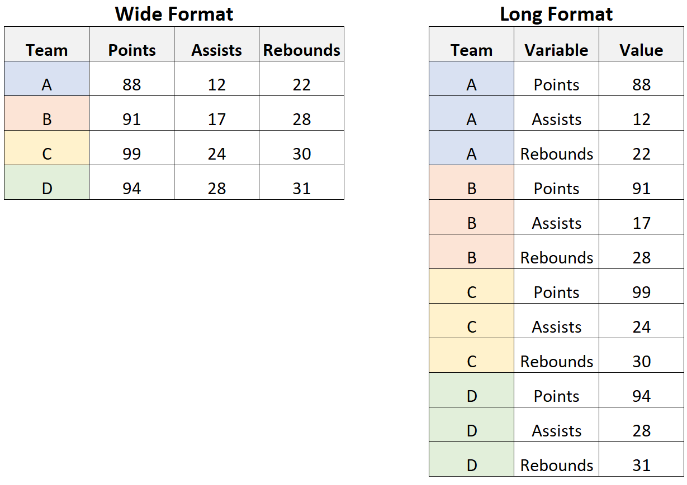
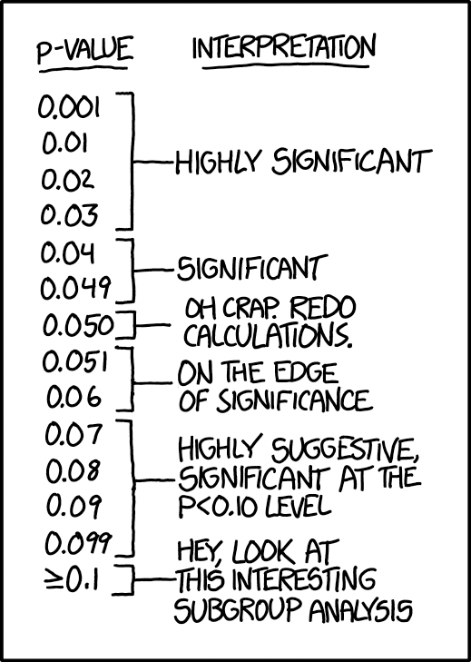
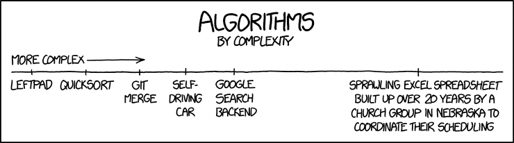

---
notion:
  title_line: "# 06) Data Wrangling: Join, Combine, and Reshape"
  role: lecture
  status: mapped
  page_id: "293d9fdd-1a1a-801c-bef2-e6140976408c"
  url: "https://app.notion.com/p/293d9fdd1a1a801cbef2e6140976408c"
---

# 06) Data Wrangling: Join, Combine, and Reshape

See [BONUS.md](BONUS.md) for the optional extensions.

**Live notebooks in Colab:** [Demo 1](https://colab.research.google.com/github/christopherseaman/datasci_217/blob/main/06/demo/demo1_merge_operations.ipynb) · [Demo 2](https://colab.research.google.com/github/christopherseaman/datasci_217/blob/main/06/demo/demo2_pivot_melt.ipynb) · [Demo 3](https://colab.research.google.com/github/christopherseaman/datasci_217/blob/main/06/demo/demo3_concat_combine.ipynb)

**Run locally:**

```shell
curl -fsSL https://raw.githubusercontent.com/christopherseaman/datasci_217/main/06/demo/setup_demo.sh | sh
```

# Notes from the Trenches

<bookmark url="https://tej.as/blog/companies-are-full-of-it"></bookmark>

<bookmark url="https://www.theregister.com/offbeat/2026/10/14/chaos-ensues-when-ai-interviewer-meets-ai-interviewee/5303144"></bookmark>

<callout icon="🧭" color="blue_bg">
	# This Lecture
	## Covers
	- **Database-style joins**: keys, `pd.merge()` and its join types, overlapping columns, multi-column keys, cross joins, and cardinality checks.
	- **Reshaping**: wide and long formats with `melt()`, `pivot()`, and `pivot_table()`, and turning two-level row labels into columns with `reset_index()`.
	- **Concatenation**: stacking rows and placing tables side by side with `concat()`, and filling missing values from a second source with `combine_first()`.
	- **Readings**: McKinney, _Python for Data Analysis_ (3rd ed.) Chapter 8.
	## Enables
	- Join a patient table to lab results with `pd.merge()`, and see which patients drop out under each join type with `indicator=True`.
	- Catch a merge that duplicates rows by checking cardinality with `validate=`.
	- Reshape blood-pressure visits between wide and long with `melt()` and `pivot()`, and find the repeated pair that stops a pivot.
	- Stack monthly admission extracts with `concat()`, record which file each row came from, and fill missing values from a second source with `combine_first()`.
</callout>

# Database-Style DataFrame Joins

- **Database-style**: a **relational database** stores data as separate tables linked by shared columns, and pandas borrows its vocabulary for combining them.
- **Join** (a **merge** in pandas): puts related rows from two tables side by side by matching a key.
- Health data rarely arrives in one table: asking whether older patients have higher A1c means joining patients to lab results first.

## Keys and the Unit of Analysis

- **Unit of analysis** (a table's **grain**): what one row represents, such as one patient or one lab test.
- **Key**: the column, or columns, whose values match rows between two tables, such as `patient_id` in both `patients` and `labs`.
- A key can repeat: one patient has many lab rows. pandas never enforces uniqueness, so check it with `df['key'].is_unique`, `df.duplicated(subset=['key'])`, or `validate=` in the merge.

```
patients: one row per patient    labs: one row per test (A1c in %, LDL in mg/dL)
┌────────────┬────────────┐      ┌────────────┬──────┬───────┐
│ patient_id │ birth_year │      │ patient_id │ test │ value │
├────────────┼────────────┤      ├────────────┼──────┼───────┤
│ P001       │ 1958       │      │ P001       │ A1c  │   6.8 │
│ P002       │ 1971       │      │ P001       │ LDL  │ 131.0 │
│ P003       │ 1985       │      │ P002       │ A1c  │   5.4 │
└────────────┴────────────┘      │ P004       │ A1c  │   7.9 │
                                 └────────────┴──────┴───────┘
```

_Join keys are the table's name tags: if two rows share a tag, pandas brings their columns together. A good key makes matching boring; a bad key turns the merge into an enthusiastic photocopier._


## Joining Tables with pd.merge()

`pd.merge(table1, table2, on='key', how=...)` pairs each row of `table1` with every row of `table2` that has the same key value, and returns a new DataFrame. The **join type** (`how=`) decides what happens to a key found in only one table:

- **Left join** (`how='left'`): keeps every row of the left table, the main table written first. It reads left to right, so it is the course default.
- **Inner join** (`how='inner'`, pandas' default): keeps only keys found in both tables.
- **Right join** (`how='right'`): keeps every row of the right table.
- **Outer join** (`how='outer'`, a **full join**): keeps every row of both tables.
- Unmatched rows get `NaN` in the other table's columns.



<callout icon="⚠️" color="yellow_bg">
	## A repeated key copies rows without an error!
</callout>

### Reference Card: `pd.merge()`

| Argument | Purpose | Typical output |
| --- | --- | --- |
| `left`, `right` | Input tables; `left.merge(right, on=...)` is the same call written as a DataFrame method | Combined `DataFrame` |
| `on='key'` or `on=['k1', 'k2']` | Shared key column, or several that must all match; without `on=`, every shared column name becomes part of the key | Key-based matches |
| `left_on`, `right_on` | Key columns with different names | Both key columns kept |
| `how='left'` | Every left row; unmatched right fields become `NaN` | Row count of left, or more if right keys repeat |
| `how='inner'` (default) | Matching keys only | Unmatched rows dropped |
| `how='right'` / `how='outer'` | Every right row / every row from both | `NaN` in unmatched fields |
| `how='cross'` | Every left row paired with every right row; takes no `on=` | `len(left) × len(right)` rows |
| `indicator=True` | Record where each row came from | `_merge` column: `both`, `left_only`, `right_only` |
| `validate=` | Check cardinality | `MergeError` when violated |
| `suffixes` | Rename overlapping non-key columns | Unambiguous columns |

### Code Snippet: Compare join types

```python
left_join = pd.merge(patients, labs, on='patient_id', how='left')
display(left_join)

audit = pd.merge(patients, labs, on='patient_id', how='outer', indicator=True)
display(audit)
```

| patient_id | birth_year | test | value |
| --- | --- | --- | --- |
| P001 | 1958 | A1c | 6.8 |
| P001 | 1958 | LDL | 131.0 |
| P002 | 1971 | A1c | 5.4 |
| P003 | 1985 | NaN | NaN |

| patient_id | birth_year | test | value | _merge |
| --- | --- | --- | --- | --- |
| P001 | 1958.0 | A1c | 6.8 | both |
| P001 | 1958.0 | LDL | 131.0 | both |
| P002 | 1971.0 | A1c | 5.4 | both |
| P003 | 1985.0 | NaN | NaN | left_only |
| P004 | NaN | A1c | 7.9 | right_only |

- **Inner**: the 3 `both` rows.
- **Left**: `both` plus `left_only` (P003, no labs yet): 4 rows.
- **Right**: `both` plus `right_only` (P004, a lab with no patient record): 4 rows.
- **Outer**: all 5 rows. `birth_year` prints as `1958.0` because P004's missing value makes the column `float64`.


<callout icon="⚠️" color="yellow_bg">
	## `merge()` is an inner join unless you say otherwise!
	Unmatched rows vanish without a warning, as P003 and P004 do in an inner join. Write `how='left'` with the main table first, and compare row counts before and after.
</callout>

_“The data clearly shows that our hypothesis is correct, assuming we ignore all the data that doesn’t support our hypothesis.”_

### Code Snippet: Match differently named keys

`referrals` calls its patient key `registry_id`; `patients` uses `patient_id`:

```text
referrals
registry_id  service
P002         cardiology
```

```python
display(pd.merge(referrals, patients, left_on='registry_id', right_on='patient_id'))
```

| registry_id | service | patient_id | birth_year |
| --- | --- | --- | --- |
| P002 | cardiology | P002 | 1971 |

Both key columns remain because their names differ.

## Handling Overlapping Column Names

When both tables have a non-key column with the same name, `merge()` keeps both and adds the suffixes `_x` (left table) and `_y` (right table).

### Reference Card: Overlapping columns

| Item | Purpose / arguments | Output / note |
| --- | --- | --- |
| Default suffixes (`_x`, `_y`) | Distinguish overlapping columns | `a1c_x` from the left table, `a1c_y` from the right |
| `suffixes=('_lab', '_poc')` | Say what each column means | Named output columns |

### Code Snippet: Name overlapping columns

`lab` holds central-lab A1c results and `poc` holds point-of-care device results for the same patients:

```text
lab                 poc
patient_id  a1c     patient_id  a1c
P001        7.4     P001        7.1
P002        5.6     P002        5.9
```

```python
display(pd.merge(lab, poc, on='patient_id'))
display(pd.merge(lab, poc, on='patient_id', suffixes=('_lab', '_poc')))
```

| patient_id | a1c_x | a1c_y |
| --- | --- | --- |
| P001 | 7.4 | 7.1 |
| P002 | 5.6 | 5.9 |

| patient_id | a1c_lab | a1c_poc |
| --- | --- | --- |
| P001 | 7.4 | 7.1 |
| P002 | 5.6 | 5.9 |


## Merging on Multiple Columns

- **Composite key**: several columns that together name a row, such as `patient_id` and `visit`.
- Pass a list, `on=['patient_id', 'visit']`; every listed column must match.

```text
vitals (sbp in mmHg)            a1c (a1c in %)
patient_id  visit     sbp       patient_id  visit     a1c
P001        baseline  152       P001        baseline  7.4
P001        followup  138       P001        followup  6.9
P002        baseline  128       P002        baseline  5.6
P002        followup  124       P002        followup  5.5
```

### Code Snippet: Merge on multiple columns

```python
wrong = pd.merge(vitals, a1c, on='patient_id')
print(len(wrong))            # 8: each visit's SBP now sits next to both of that patient's A1c values
print(list(wrong.columns))   # ['patient_id', 'visit_x', 'sbp', 'visit_y', 'a1c']: _x and _y mark the clashing visit columns

merged = pd.merge(vitals, a1c, on=['patient_id', 'visit'])
display(merged)
```

| patient_id | visit | sbp | a1c |
| --- | --- | --- | --- |
| P001 | baseline | 152 | 7.4 |
| P001 | followup | 138 | 6.9 |
| P002 | baseline | 128 | 5.6 |
| P002 | followup | 124 | 5.5 |

## Pairing Every Row with a Cross Join

- **Cross join** (`how='cross'`): pairs every row of one table with every row of the other. It uses no key.
- Row count: `len(left) × len(right)`, so 2 clinics and 3 hours give 6 rows.

```text
clinic_list    hours     pd.merge(clinic_list, hours, how='cross')
clinic         hour      clinic  hour
North          8         North   8
South          9         North   9
               10        North   10
                         South   8
                         South   9
                         South   10
```

- **Use**: find records that never arrived. A missing report has no row, so no keyed join can flag it.
- Build the **expected grid** of every clinic at every hour with a cross join.
- Left-merge the reports that arrived onto the grid with `indicator=True`: each missing report shows up as `left_only`.

### Code Snippet: Find missing reports with a cross join

`reports` holds the four hourly reports that arrived:

```text
clinic  hour  arrivals
North   8     3
North   10    0
South   8     5
South   9     2
```

```python
expected = pd.merge(clinic_list, hours, how='cross')
coverage = pd.merge(expected, reports, on=['clinic', 'hour'], how='left', indicator=True)
display(coverage)
```

| clinic | hour | arrivals | _merge |
| --- | --- | --- | --- |
| North | 8 | 3.0 | both |
| North | 9 | NaN | left_only |
| North | 10 | 0.0 | both |
| South | 8 | 5.0 | both |
| South | 9 | 2.0 | both |
| South | 10 | NaN | left_only |

North's 9:00 `NaN` means no report arrived; its 10:00 `0.0` is a real report of zero arrivals.


## Checking Merge Cardinality

- **Cardinality**: how many rows each key value can match on each side.
- **One-to-one**: each key appears once in both tables, such as central-lab and point-of-care A1c tables with one row per patient.
- **One-to-many** (or **many-to-one**, read from the other side): many lab rows per patient, or many visits per clinic in a **lookup table** of one row per clinic.
- **Many-to-many**: keys repeat on both sides; every pairing becomes a row.
- A repeated key in a lookup table copies each matching row once per repeat, with no error.
- Row growth alone proves nothing, because a one-to-many merge adds rows too. State the expected relationship with `validate=`.

### Reference Card: Merge cardinality and audit

| Contract | Meaning | Check |
| --- | --- | --- |
| One-to-one | Unique keys on both sides | `validate='one_to_one'` |
| One-to-many | Unique left keys; repeated right keys allowed | `validate='one_to_many'` |
| Many-to-one | Repeated left keys; unique right keys | `validate='many_to_one'` |
| Many-to-many | Repeated keys on both sides | `validate='many_to_many'` documents, not constrains |
| Broken contract | A side you declared unique has repeats | Raises `pd.errors.MergeError` |
| Find the repeats | Every row whose key appears more than once | `df[df.duplicated(subset=['key'], keep=False)]`; list every column of a composite key |
| Missing keys | Missing (`NA`) keys match each other | `df['key'].notna().all()` on both tables before merging |
| Match audit | Show `left_only`, `right_only`, `both` | `indicator=True` |

### Code Snippet: Catch a broken merge contract

Each visit should get one clinic name. `clinics` lists K2 twice; `clinics_fixed` lists it once:

```text
visits                   clinics                         clinics_fixed
visit_id  clinic_id      clinic_id  clinic_name          clinic_id  clinic_name
V1        K1             K1         Mission Bay          K1         Mission Bay
V2        K2             K2         Parnassus            K2         Parnassus
V3        K2             K2         Parnassus Annex
V4        K9
```

```python
display(pd.merge(visits, clinics_fixed, on='clinic_id', how='left', validate='many_to_one'))
```

| visit_id | clinic_id | clinic_name |
| --- | --- | --- |
| V1 | K1 | Mission Bay |
| V2 | K2 | Parnassus |
| V3 | K2 | Parnassus |
| V4 | K9 | NaN |

```python
pd.merge(visits, clinics, on='clinic_id', how='left', validate='many_to_one')
```

```text
MergeError: Merge keys are not unique in right dataset; not a many-to-one merge

Duplicates in right:
 clinic_id
       K2 ...
```

Without `validate=`, the second merge returns 6 rows from 4 visits.

# LIVE DEMO!

[Open Demo 1 in Colab](https://colab.research.google.com/github/christopherseaman/datasci_217/blob/main/06/demo/demo1_merge_operations.ipynb)

# Reshaping: Wide vs Long Format

- **Reshaping**: changing the layout of a table. A lossless reshape preserves every measurement; **aggregation** reduces several values to one summary and cannot recover the originals.
- **Wide**: measurements of one kind spread across columns, such as a systolic blood pressure (SBP) column per visit.
- **Long**: one row per measurement, such as one row per patient-visit; grouping and plotting tools usually want this layout.
- In long data, the **identifier columns** (`patient_id`, `visit`) say which observation a row is, and the **value column** (`sbp`) holds the measurement.
- Long data with one observation per row and one variable per column is often called **tidy** data.



| Shape | One row represents | Best for | Conversion |
| --- | --- | --- | --- |
| Wide | One entity with several measured columns | Side-by-side comparison | `melt()` to long |
| Long | One entity/variable observation | Grouping and tidy plotting | `pivot()` to wide |


## Melting Wide to Long with melt()

`melt()`, written `pd.melt(df, ...)` or `df.melt(...)`, keeps the identifier columns fixed and turns each selected column into rows: the old column name goes into a variable column and its cell into a value column. Questionnaire answers stored in `Q1`, `Q2`, and `Q3` columns melt the same way, with the question name as the variable.

### Reference Card: `melt()`

| Argument | Purpose | Output |
| --- | --- | --- |
| `id_vars` | Columns to keep fixed | Identifier columns repeated |
| `value_vars` | Columns to unpivot | One row per source row and selected value column |
| `var_name` | Name for former column labels | Variable column |
| `value_name` | Name for former cell values | Value column |

### Code Snippet: Melt wide data

`wide` has one SBP column per visit:

```text
patient_id  baseline  followup
P001        152       138
P002        138       132
P003        145       129
```

```python
long = pd.melt(wide, id_vars=['patient_id'], value_vars=['baseline', 'followup'],
               var_name='visit', value_name='sbp')
display(long)
```

| patient_id | visit | sbp |
| --- | --- | --- |
| P001 | baseline | 152 |
| P002 | baseline | 138 |
| P003 | baseline | 145 |
| P001 | followup | 138 |
| P002 | followup | 132 |
| P003 | followup | 129 |

## Spreading One Column's Values into Columns with pivot()

- `pivot()` turns a long table into a wide one: each distinct value of the `columns` column becomes its own column.
- `index` names the column that labels the rows, and `values` names the column that fills the cells.
- Use it for a reader, or to compare baseline with follow-up side by side.
- It files each value by its labels, so the long rows may come in any order.
- It never aggregates, so each `index`/`columns` pair must identify exactly one value.

### Reference Card: `pivot()`

| Argument | Purpose | Constraint / output |
| --- | --- | --- |
| `index` | Column becoming row labels | One row per index value; a list such as `['id1', 'id2']` gives two-level row labels |
| `columns` | Column becoming headers | One column per value |
| `values` | Column filling cells | Duplicate index/column pairs raise an error |
| `.reset_index()` afterward | Turn the row labels into an ordinary column | Leaves the `columns` name as a header label |
| `result.columns.name = None` | Drop that leftover header label | Plain column headers |

### Code Snippet: Spread visits into columns

```python
spread = long.pivot(index='patient_id', columns='visit', values='sbp')
display(spread)

spread = spread.reset_index()
spread.columns.name = None   # drop the leftover 'visit' header label
display(spread)
print(spread.equals(wide))   # True: identical to the wide table melted above
```

| visit | baseline | followup |
| --- | --- | --- |
| **patient_id** |  |  |
| P001 | 152 | 138 |
| P002 | 138 | 132 |
| P003 | 145 | 129 |

| patient_id | baseline | followup |
| --- | --- | --- |
| P001 | 152 | 138 |
| P002 | 138 | 132 |
| P003 | 145 | 129 |


## Repeated Row-Column Pairs: pivot() Fails, pivot_table() Aggregates

- **Problem**: two rows share an `index`/`columns` pair, such as two follow-up readings for one patient.
- **`pivot()`** cannot choose a cell value and stops with `ValueError: Index contains duplicate entries, cannot reshape`.
- **Find them**: `df[df.duplicated(subset=['patient_id', 'visit'], keep=False)]` lists every row in a repeated pair.
- **Decide**: a data error, or a real repeated observation such as a recheck?
- **Keep one row** by a documented rule: to keep the later recheck, `sort_values('reading_time')`, then `drop_duplicates(subset=['patient_id', 'visit'], keep='last')`.
- **Keep both** with `pivot_table()`, which aggregates repeated pairs into one cell; the choice of `mean`, `sum`, or another function changes the question being answered.

### Code Snippet: Find the pair that stops a pivot

`rechecked` holds one baseline reading per patient and two follow-up readings for P002:

| patient_id | visit | sbp | reading_time |
| --- | --- | --- | --- |
| P001 | baseline | 150 | 09:00 |
| P002 | baseline | 140 | 09:30 |
| P003 | baseline | 145 | 09:45 |
| P002 | followup | 148 | 10:15 |
| P002 | followup | 136 | 10:22 |

`rechecked.pivot(index='patient_id', columns='visit', values='sbp')` raises the repeated-pair error. List the rows that share a pair:

```python
display(rechecked[rechecked.duplicated(subset=['patient_id', 'visit'], keep=False)])
```

| patient_id | visit | sbp | reading_time |
| --- | --- | --- | --- |
| P002 | followup | 148 | 10:15 |
| P002 | followup | 136 | 10:22 |

### Reference Card: `pivot_table()`

`df.pivot_table(index=..., columns=..., values=..., aggfunc='mean')` reshapes long to wide like `pivot()`, but aggregates every repeated `index`/`columns` pair into one cell.

| Argument | Purpose | Effect |
| --- | --- | --- |
| `index`, `columns`, `values` | Same roles as in `pivot()` | Row labels, headers, and the column filling cells |
| `aggfunc` | Summary for repeated pairs: `'mean'` (default), `'sum'`, `'count'`, `'max'`, ... | Picks the value each cell holds |

Returns a wide `DataFrame`; repeated pairs never raise an error. `values` must be numeric for `'mean'`: a text column raises `TypeError: dtype 'str' does not support operation 'mean'`, and `'sum'` joins the text instead.

### Code Snippet: Summarize repeated readings with `pivot_table()`

On the `rechecked` table above, the two P002 follow-up rechecks become one cell, `(148 + 136) / 2 = 142` mmHg; patients with no follow-up get `NaN`.

```python
display(rechecked.pivot_table(index='patient_id', columns='visit',
                              values='sbp', aggfunc='mean'))
```

| visit | baseline | followup |
| --- | --- | --- |
| **patient_id** |  |  |
| P001 | 150.0 | NaN |
| P002 | 140.0 | 142.0 |
| P003 | 145.0 | NaN |

`aggfunc='mean'` is the default; naming it records the decision. This answers “What was the average reading?”, while keeping the later recheck answers “What reading did the protocol record?” Aggregation is not lossless: the mean alone cannot recover the two readings.



## Turning Two-Level Row Labels into Columns with reset_index()

- **Two-level row labels** (a **MultiIndex**): each row is labeled by two values, such as a `(patient_id, visit)` pair. The outer label prints once, with the inner labels under it.
- They appear when `index=` gets a list, as in `pivot()` or `pivot_table()`.
- `reset_index()` turns every level back into an ordinary column, so filtering, merging, and saving work as usual.

### Reference Card: Two-level row labels

- `df.pivot_table(index=['col1', 'col2'], values='val')`: one row per `col1`/`col2` pair, labeled by both.
- `result.index.names`: the level names, such as `['patient_id', 'visit']`.
- `result.reset_index()`: a new `DataFrame` with each level as a column and plain row numbers.

### Code Snippet: Flatten a two-level result

```python
per_visit = rechecked.pivot_table(index=['patient_id', 'visit'], values='sbp', aggfunc='mean')
display(per_visit)
display(per_visit.reset_index())
```

| patient_id | visit | sbp |
| --- | --- | --- |
| P001 | baseline | 150.0 |
| P002 | baseline | 140.0 |
|  | followup | 142.0 |
| P003 | baseline | 145.0 |

| patient_id | visit | sbp |
| --- | --- | --- |
| P001 | baseline | 150.0 |
| P002 | baseline | 140.0 |
| P002 | followup | 142.0 |
| P003 | baseline | 145.0 |

After `reset_index()`, `patient_id` repeats on every row: it is an ordinary column again.


# LIVE DEMO!

[Open Demo 2 in Colab](https://colab.research.google.com/github/christopherseaman/datasci_217/blob/main/06/demo/demo2_pivot_melt.ipynb)

# Concatenating DataFrames Along an Axis

- **Concatenation**: gluing together tables that are pieces of one table, such as monthly admission extracts with the same columns.
- **Axis**: `axis=0` stacks rows; `axis=1` puts columns side by side.
- `concat()` does not match key values the way `merge()` does. Stacking (`axis=0`) aligns columns by name; side by side (`axis=1`) aligns rows by index label.

```
VERTICAL CONCATENATION (axis=0)
DataFrame A:      DataFrame B:      Result:
┌─────────┐       ┌─────────┐       ┌─────────┐
│ A │ B   │   +   │ A │ B   │   =   │ A │ B   │
├─────────┤       ├─────────┤       ├─────────┤
│ 1 │ 2   │       │ 5 │ 6   │       │ 1 │ 2   │
│ 3 │ 4   │       │ 7 │ 8   │       │ 3 │ 4   │
└─────────┘       └─────────┘       │ 5 │ 6   │
                                    │ 7 │ 8   │
                                    └─────────┘

HORIZONTAL CONCATENATION (axis=1): rows line up by index label
DataFrame A:      DataFrame B:
┌───────────┐     ┌───────────┐
│   │ A │ B │     │   │ C │ D │
├───────────┤     ├───────────┤
│ 0 │ 1 │ 2 │  +  │ 1 │ 5 │ 6 │
│ 1 │ 3 │ 4 │     │ 2 │ 7 │ 8 │
└───────────┘     └───────────┘
Result (outer join keeps every label):
┌───────────────────┐
│   │ A │ B │ C │ D │
├───────────────────┤
│ 0 │ 1 │ 2 │NaN│NaN│
│ 1 │ 3 │ 4 │ 5 │ 6 │
│ 2 │NaN│NaN│ 7 │ 8 │
└───────────────────┘
```



## Stacking Rows with concat()

`pd.concat([df1, df2])` stacks tables with the same columns, one under the other; columns line up by name. Count the rows in each file first so you know what the stack should hold.

### Code Snippet: Count each extract's lines with `%%bash`

`!command` runs one shell line; a cell whose first line is `%%bash` (a **cell magic**) runs the whole cell in the shell. `wc -l` counts the header too, so each extract has one row fewer than its count:

```python
%%bash
wc -l data/*_admissions.csv
```

```text
 3 data/feb_admissions.csv
 4 data/jan_admissions.csv
 7 total
```

### Reference Card: `concat()` for rows

| Call | Purpose | Result |
| --- | --- | --- |
| `pd.concat([df1, df2])` | Stack rows (`axis=0`) | Appended rows; indexes may repeat |
| `ignore_index=True` | Replace source indexes | Fresh `RangeIndex` |
| `piece['source_file'] = 'jan.csv'` on each table before stacking | Record where each row came from, its **provenance** | An ordinary label column that survives the stack |
| `keys=['jan', 'feb']`, `names=['source', 'row']` | Label each piece with an outer index level instead of a column | Two-level row index; `reset_index()` turns the labels into columns |

### Code Snippet: Stack rows

`jan` holds three January admissions and `feb` two February ones, with the same columns (`los_days` is the length of stay):

```text
jan                         feb
admission_id  unit  los_days admission_id  unit  los_days
A101          ICU   4        A201          Med   5
A102          Med   2        A202          ICU   1
A103          Surg  3
```

```python
jan['source_file'] = 'jan_admissions.csv'
feb['source_file'] = 'feb_admissions.csv'
combined = pd.concat([jan, feb])
display(combined)

combined = pd.concat([jan, feb], ignore_index=True)
print(list(combined.index))   # [0, 1, 2, 3, 4]: a clean sequential index
```

The index column stays in this output because it repeats `0` and `1`: each piece kept its own row numbers.

|  | admission_id | unit | los_days | source_file |
| --- | --- | --- | --- | --- |
| 0 | A101 | ICU | 4 | jan_admissions.csv |
| 1 | A102 | Med | 2 | jan_admissions.csv |
| 2 | A103 | Surg | 3 | jan_admissions.csv |
| 0 | A201 | Med | 5 | feb_admissions.csv |
| 1 | A202 | ICU | 1 | feb_admissions.csv |


## Keeping Shared or All Columns with concat(join=...)

- Extracts change over time: a column is dropped, another added.
- `join=` decides which columns the stack keeps.
- **`join='outer'`** (default): every column from any piece; `NaN` where a piece lacks it.
- **`join='inner'`**: only the columns every piece has.

### Reference Card: `concat(join=...)`

| Item | Purpose / arguments | Output / note |
| --- | --- | --- |
| `join='outer'` (default) | Keep all columns from both frames | Union of columns; `NaN` where a piece lacks a column |
| `join='inner'` | Keep only columns shared by all inputs | Stacked `DataFrame` with the column intersection |

### Code Snippet: Choose a column set

This `jan` and `feb` are two admission extracts whose columns changed: February dropped `age` and added `payer`.

```text
jan                            feb
admission_id  age  los_days    admission_id  los_days  payer
A101          67   4           A201          5         Medicare
A102          45   2           A202          1         Private
```

```python
display(pd.concat([jan, feb], join='outer', ignore_index=True))
display(pd.concat([jan, feb], join='inner', ignore_index=True))
```

| admission_id | age | los_days | payer |
| --- | --- | --- | --- |
| A101 | 67.0 | 4 | NaN |
| A102 | 45.0 | 2 | NaN |
| A201 | NaN | 5 | Medicare |
| A202 | NaN | 1 | Private |

| admission_id | los_days |
| --- | --- |
| A101 | 4 |
| A102 | 2 |
| A201 | 5 |
| A202 | 1 |


## Placing Tables Side by Side with concat(axis=1)

- Separate systems can report different variables for the same patients.
- `pd.concat([df1, df2], axis=1)` puts their columns side by side, matching rows by index label.
- Set the patient identifier as each table's index first; rows then line up even when they arrive in different orders.

### Reference Card: `concat(axis=1)`

| Call / rule | Purpose | Result |
| --- | --- | --- |
| `pd.concat([df1, df2], axis=1)` | Add columns | Index labels align rows |
| Shared index labels | Define row identity | Matching labels share a row |
| Missing labels | Preserve unmatched rows | `NaN` in absent fields |
| `axis=1, join='inner'` | Keep only row labels found in every input | Side-by-side `DataFrame` without unmatched rows |

### Code Snippet: Align columns by index

`a1c` and `vitals` both use `patient_id` as their index, and only P002 and P003 appear in both:

```text
a1c                 vitals
patient_id  a1c     patient_id  sbp  weight_kg
P001        7.4     P002        128  81.5
P002        5.6     P003        141  67.0
P003        6.1     P004        119  90.2
```

```python
combined = pd.concat([a1c, vitals], axis=1)
display(combined)
```

| patient_id | a1c | sbp | weight_kg |
| --- | --- | --- | --- |
| P001 | 7.4 | NaN | NaN |
| P002 | 5.6 | 128.0 | 81.5 |
| P003 | 6.1 | 141.0 | 67.0 |
| P004 | NaN | 119.0 | 90.2 |

<callout icon="⚠️" color="yellow_bg">
	## `axis=1` matches rows by index label!
	Two tables numbered `0, 1, 2` pair row 0 with row 0, whoever those patients are. Set the patient ID as the index first, or use `merge()`.
</callout>

## Filling Missing Values from a Second Source with combine_first()

- Two sources can record the same variable for the same patients, such as a primary weight record and an intake form.
- `primary.combine_first(backup)` fills each missing value (`NaN`) in `primary` with `backup`'s value at the same row and column labels.
- Values already present in `primary` win; rows or columns found only in `backup` are added.

### Reference Card: `combine_first()`

| Item | Purpose / arguments | Output / note |
| --- | --- | --- |
| `df1.combine_first(df2)` | Fill `df1`'s `NaN` cells from the same row and column labels in `df2` | New `DataFrame`; non-null `df1` values win |
| Row and column coverage | Keep the union of both sets of labels | Rows or columns found only in `df2` are included |
| Not a stack | Fills values of the same observations from a second source | To add another period's observations, use `concat()` |
| Matching labels | `P002` and `weight_kg` must mean the same patient and unit in both sources | Check before combining; pandas matches names, not meaning |

### Code Snippet: Fill missing weights from the intake form

`primary` and `intake` both use `patient_id` as their index; the primary record has no weight for P002:

```text
primary                   intake
patient_id  weight_kg     patient_id  weight_kg
P001        81.5          P002        74.8
P002        NaN           P003        66.1
P003        67.0          P004        90.2
```

```python
complete = primary.combine_first(intake)
display(complete)
```

| patient_id | weight_kg |
| --- | --- |
| P001 | 81.5 |
| P002 | 74.8 |
| P003 | 67.0 |
| P004 | 90.2 |

P002 is filled from the intake form, P003 keeps the primary 67.0 over the intake's 66.1, and P004 comes only from the intake form.


# LIVE DEMO!

[Open Demo 3 in Colab](https://colab.research.google.com/github/christopherseaman/datasci_217/blob/main/06/demo/demo3_concat_combine.ipynb)
