---
notion:
  title_line: "# Data Aggregation and Group Operations"
  role: lecture
  status: mapped
  page_id: "2a1d9fdd-1a1a-80f8-b1e8-f7b20e4a2e84"
  url: "https://app.notion.com/p/2a1d9fdd1a1a80f8b1e8f7b20e4a2e84"
---

# Data Aggregation and Group Operations

See [BONUS.md](BONUS.md) for the optional extensions.

**Live notebooks in Colab:** [Demo 0](https://colab.research.google.com/github/christopherseaman/datasci_217/blob/main/08/demo/demo0_eda_pass.ipynb) · [Demo 1](https://colab.research.google.com/github/christopherseaman/datasci_217/blob/main/08/demo/demo1_groupby_operations.ipynb) · [Demo 2](https://colab.research.google.com/github/christopherseaman/datasci_217/blob/main/08/demo/demo2_coverage_result_shapes.ipynb) · [Demo 3](https://colab.research.google.com/github/christopherseaman/datasci_217/blob/main/08/demo/demo3_remote_performance.ipynb)

**Run locally:**

```shell
curl -fsSL https://raw.githubusercontent.com/christopherseaman/datasci_217/main/08/demo/setup_demo.sh | sh
```

_"Aggregation" comes from the Latin "aggregare," to add to a flock, which is what a groupby does with scattered rows._

<callout icon="🧭" color="blue_bg">
	# This Lecture
	## Covers
	- **Exploratory data analysis**: the steps of EDA in order, missing values by group, the IQR rule for outliers, and pairplots.
	- **GroupBy, pivot tables, and crosstabs**: `groupby()` by one or two keys with named aggregation, Simpson's paradox when a second key reverses a comparison, and `pivot_table()` and `pd.crosstab()` with totals, row shares, and fills for absent cells.
	- **Group coverage and result shapes**: missing keys, unused categories, and `transform`, `filter`, and `apply`.
	- **Performance optimization**: one `.agg()` per split, built-in aggregations over lambdas, and `category` keys, checked with `%timeit` and `memory_usage()`.
	- **tmux and SSH**: `tmux` sessions that keep long jobs running, then `ssh`, `scp`, and key pairs for remote servers.
	- **Readings**: McKinney, _Python for Data Analysis_ (3rd ed.) 7.5, 9.2 (pair plots), and 10.1 to 10.5; Shotts, _The Linux Command Line_, Chapter 16; MIT _The Missing Semester of Your CS Education_, "Command-line Environment".
	## Enables
	- Explore a visit log before grouping it, from `info()` and missing shares by clinic to an IQR fence and `sns.pairplot()`.
	- Summarize a visit log into one row per clinic with named aggregations, and into a department-by-clinic pivot table or crosstab with totals and zeros where no visits occurred.
	- Keep visits with no clinic recorded and clinics with no visits in a report using `dropna=False`, `pd.Categorical`, and `observed=False`.
	- Compare each visit's wait with its own department's mean using `transform`, and keep only departments that pass a size or mean rule with `filter`.
	- Copy data to a server with `scp`, run an analysis inside `tmux`, and reattach after the connection drops.
</callout>

<video src="media/swedish-delight.mp4"></video>

<pdf src="media/RedSoloCupTracking.pdf"></pdf>

<pdf src="media/Regression-Abuse-SIM-44-0.pdf"></pdf>

<bookmark url="https://qz.com/anthropic-mithril-medicine-acquisition-drug-programs-102826"></bookmark>

<pdf src="media/Mithril-technical-report-v0.6-journal-style.pdf"></pdf>

# Exploratory Data Analysis Before Grouping

- **Exploratory data analysis (EDA)**: looking over a table before summarizing or modeling it, to learn what one row means, what is missing, and which values or patterns need a closer look.
- The steps run in order because each depends on the one before: a missing share means little until you know what one row is.
- Every step uses tools from Lectures 04 to 07 except the pairplot and one `groupby` preview. Its findings choose the grouped questions: waits missing more often at one clinic, or a long tail of waits, say which `groupby` to run next.

## Five Steps, in Order

### Reference Card: The Steps of EDA

| Step | Ask | Method |
| --- | --- | --- |
| 1. Question and grain | What is the question, and what does one row represent? | `df.head()`; compare `df['id'].nunique()` with `len(df)` |
| 2. Structure | Which columns, types, counts, and ranges? | `df.info()`, `df.describe()` |
| 3. Missing values | How much is missing, overall and by group? | `df.isna().mean()`, `df['x'].isna().groupby(df['g']).mean()` |
| 4. Distributions and outliers | What shape, and which values are extreme? | Histogram and box plot (`sns.histplot`, `sns.boxplot`); the IQR fence |
| 5. Relationships | Which columns move together, and how? | `df[cols].corr()`, `sns.pairplot(df[cols].sample(2000), corner=True)` |

`visits` in these snippets is Demo 0's visit log: 1.2 million synthetic visits, one row per visit.

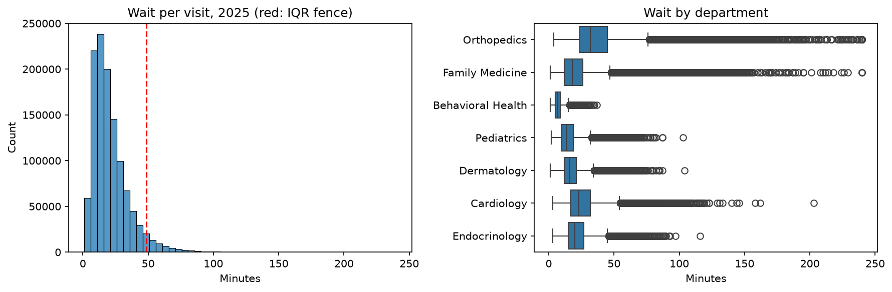

The IQR fence sits at 48.5 minutes; 47,266 visits (3.9%) wait longer. The longest wait is 240 minutes, plausible for a clinic, so these stay in the data and pull each mean above its median.

### Code Snippet: Missing Waits by Clinic

```python
display(visits['wait_min'].isna().groupby(visits['clinic']).mean().round(3))
```

| clinic | wait_min |
| --- | --- |
| Bayview | 0.027 |
| Excelsior | 0.074 |
| Marina | 0.020 |
| Mission | 0.025 |
| Parkside | 0.024 |
| Richmond | 0.022 |
| Ridgecrest | 0.018 |
| Sunset | 0.022 |

Each value is the share of that clinic's visits with no wait recorded. Preview: `.groupby(visits['clinic'])` computes the share separately for each clinic; the next sections teach `groupby`.

Overall, 2.9% of visits have no wait recorded, but Excelsior loses 7.4%, so its summary rests on fewer visits than its neighbors'.

## Pairwise Plots

A **pairplot** draws a scatter plot for every pair of numeric columns, with each column's histogram on the diagonal. Use it to scan several columns at once; once you know which pair matters, draw that one scatter plot with labels. `corner=True` drops the mirrored upper half, and a 2,000-row sample keeps it fast and the points readable.

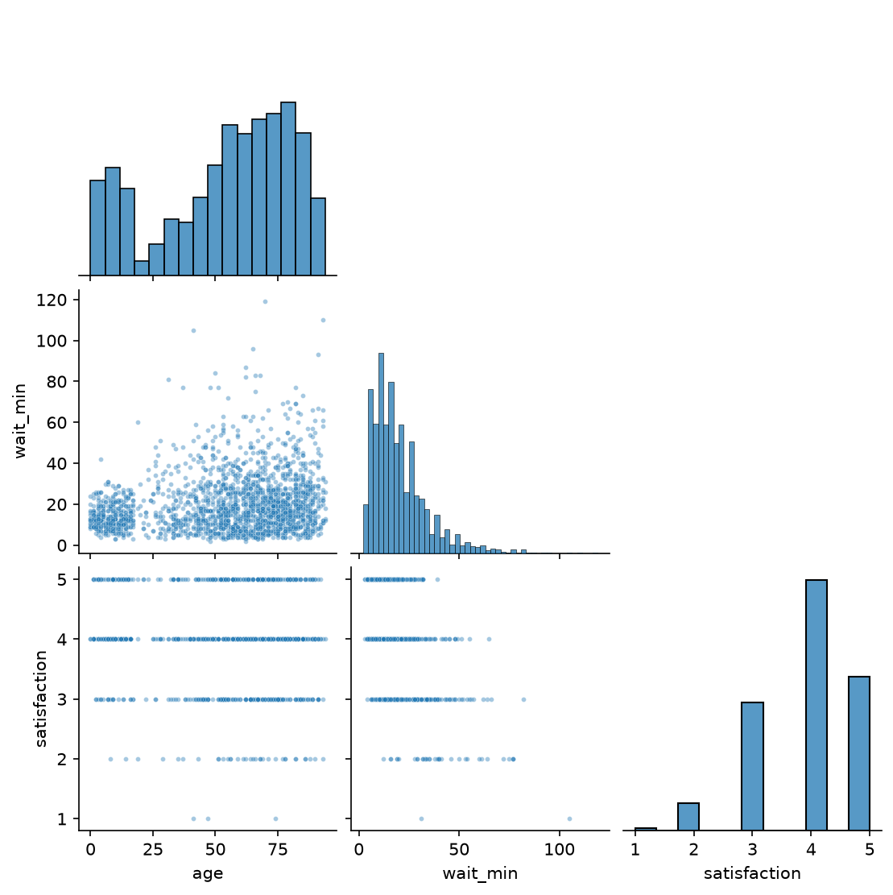

- **r**: correlation, from -1 through 0 to 1; `.corr()` gives every pair.
- **r squared**: the share of one column's variation a straight line on the other accounts for; it drops the sign, so wait and satisfaction's r of -0.48 becomes 0.23.

Each r uses only the rows where both columns are recorded: wait and satisfaction, -0.48, from 665 of the 2,000 sampled visits (most visits have no survey); age and wait, 0.20, from 1,936. The cluster of short waits under age 18 hints that department, not age, drives the wait, a question for `groupby`.

### Reference Card: Pairplots in seaborn

- `sns.pairplot(sample, corner=True)`: Scatter for every pair, histograms on the diagonal; returns a grid saved with `.savefig('pairplot.png')`.
- `grid.map_lower(func)`: Call `func(x, y)` once per lower panel with that panel's two columns as Series; inside it, `plt.gca().annotate(text, xy=(0.95, 0.95), xycoords='axes fraction')` writes on the current panel.
- `x.corr(y)`: r for two Series, skipping rows where either is missing; `df.corr()` gives every pair as a table.

### Code Snippet: Pairplot in seaborn

```python
cols = ['age', 'wait_min', 'satisfaction']
sample = visits[cols].sample(2000, random_state=217)
grid = sns.pairplot(sample, corner=True, plot_kws={'s': 8, 'alpha': 0.4})

def show_r(x, y, **kwargs):
    plt.gca().annotate(f'r = {x.corr(y):.2f}', xy=(0.95, 0.95), xycoords='axes fraction',
                       ha='right', va='top', backgroundcolor='white')

grid.map_lower(show_r)
```

## Pairwise Plots in Altair

Altair builds a pairplot as a **repeated chart**: one scatter specification that Vega-Lite draws once for every row and column pair. Altair refuses data over 5,000 rows by default (`MaxRowsError`), one more reason to sample first.

A repeated chart has no per-panel hook like seaborn's `map_lower`, and Altair's `transform_regression(..., params=True)`, which reports `rSquared`, rejects `alt.repeat()` fields. Show r instead as a **correlation heatmap** beside the scatter: one colored, labeled cell per pair of columns.

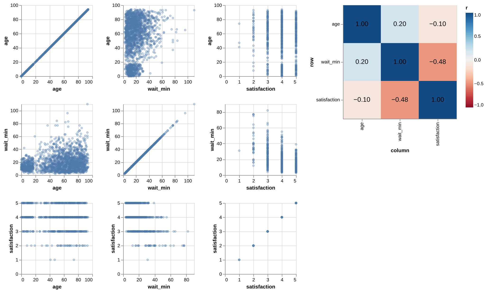

### Reference Card: Pairplots in Altair

- `alt.X(alt.repeat('column'), type='quantitative')`: Fill the x encoding from the repeat list; `alt.repeat('row')` fills y.
- `.repeat(row=cols, column=cols)`: Draw the chart once per pair of columns in `cols`.
- `brush = alt.selection_interval(resolve='global')`, `.add_params(brush)`, `color=alt.condition(brush, alt.value('steelblue'), alt.value('lightgray'))`: Drag a box in any panel to keep the selected points colored in every panel; double-click clears it.
- `df.corr().rename_axis(index='row', columns='column').stack().reset_index(name='r')`: The correlation table in long form, one row per pair, ready for `mark_rect()` (colored cells) layered with `mark_text()` (the r labels) using `+`; `chart | heatmap` places two charts side by side.
- `chart.save('pairplot.html')` / `chart.save('pairplot.json')`: A web page that draws the chart in a browser, or the Vega-Lite specification with the rows embedded.
- **Choosing**: seaborn for a static image in a report, slide, or PDF; Altair for a web page or dashboard where readers hover for tooltips.

### Code Snippet: Pairplot and Correlation Heatmap in Altair

```python
chart = alt.Chart(sample).mark_point(size=10, opacity=0.4).encode(
    alt.X(alt.repeat('column'), type='quantitative'),
    alt.Y(alt.repeat('row'), type='quantitative'),
    tooltip=cols,
).properties(width=150, height=150).repeat(row=cols, column=cols)

r = sample.corr().rename_axis(index='row', columns='column').stack().reset_index(name='r')
base = alt.Chart(r).encode(alt.X('column:N', sort=cols), alt.Y('row:N', sort=cols))
heat = base.mark_rect().encode(alt.Color('r:Q', scale=alt.Scale(scheme='redblue', domain=[-1, 1])))
labels = base.mark_text(fontSize=14).encode(alt.Text('r:Q', format='.2f'))
(chart | (heat + labels).properties(width=240, height=240)).save('pairplot.html')
```

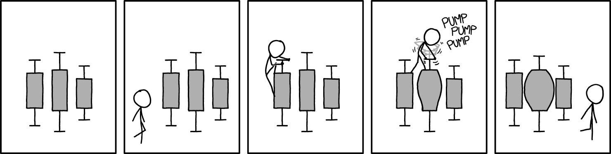

# LIVE DEMO!

[Open Demo 0 in Colab](https://colab.research.google.com/github/christopherseaman/datasci_217/blob/main/08/demo/demo0_eda_pass.ipynb)

# The Split-Apply-Combine Paradigm

- **Split-apply-combine**: the pattern behind every grouped summary; pandas runs it with `groupby()`. It answers questions such as "What is the average wait at each clinic?" from a visit log with one row per visit, returning one row per clinic.
- **Split**: sort rows into **groups** by a **grouping key**, a column whose values decide which group each row joins (here, `clinic`).
- **Apply**: run a calculation on each group separately (here, the mean of `wait_min`).
- **Combine**: collect the per-group results into a new table.
- Grouping usually changes the **grain**, what one row represents, so name it before and after.
- **Where it comes up**: a monthly clinic report (visits and mean wait per clinic), a lab audit (tests per patient), and model features such as each patient's visit count from an encounter log.

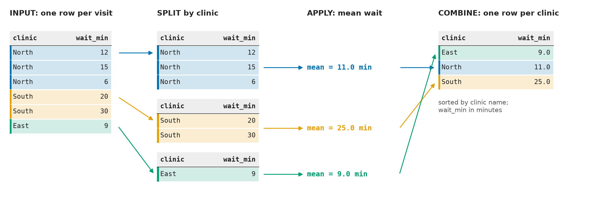

# Basic GroupBy Operations

- **GroupBy object**: what `df.groupby('clinic')` returns, a record of which rows belong to which group, not yet a summary table.
- **Aggregation**: a calculation that reduces each group's values to one number, such as a mean or a count. Nothing is calculated until you choose a column and an aggregation.

## Aggregating Each Group

From here on, `visits` is a six-row table, so each step's output fits on screen:

|  | clinic | visit_type | patient_id | wait_min | satisfaction |
| --- | --- | --- | --- | --- | --- |
| 0 | North | New | P01 | 12 | 4.0 |
| 1 | North | Follow-up | P02 | 15 | NaN |
| 2 | North | Follow-up | P01 | 6 | 5.0 |
| 3 | South | New | P03 | 20 | 3.0 |
| 4 | South | New | P04 | 30 | NaN |
| 5 | East | Follow-up | P05 | 9 | 4.0 |

### Reference Card: GroupBy Aggregation

| Task | Call | Purpose and key arguments | Output |
| --- | --- | --- | --- |
| Split | `df.groupby('key')` | Group rows by one key, or by a list of keys such as `['clinic', 'visit_type']` | `DataFrameGroupBy`; nothing computed yet |
| Split | `s.groupby(df['key'])` | Group a Series, such as `df['x'].isna()`, by another column of the same rows | `SeriesGroupBy` |
| Inspect | `for name, group in grouped:` | See each group's key and rows before summarizing | One small DataFrame per group |
| Summarize | `grouped['col'].mean()` (or `median`, `sum`, `min`, `max`) | One summary per group of a numeric column; text columns raise `TypeError` | One row per group |
| Count | `.size()` / `['col'].count()` / `['col'].nunique()` | Rows, non-missing values, distinct values per group | One count per group |
| Several at once | `.agg(name=('col', 'func'), ...)` | **Named aggregation**: each keyword names an output column from a `(source column, function)` pair | One flat column per name |
| Several at once | `['col'].agg(['size', 'mean'])` / `.agg({'col': ['mean', 'max']})` | A quick list of functions, or a dict of lists per column | Columns named after the functions; a dict gives two-level labels |
| Result shape | `as_index=False` / `result.unstack()` / `wide.stack()` | Keep keys as columns; move the inner key of a two-key result into columns, or back | Flat table / grid / long |

### Code Snippet: Count and Summarize Each Clinic

```python
summary = visits.groupby('clinic', as_index=False).agg(
    visits=('patient_id', 'size'),
    patients=('patient_id', 'nunique'),
    rated=('satisfaction', 'count'),
    mean_wait=('wait_min', 'mean'),
)
display(summary)
```

|  | clinic | visits | patients | rated | mean_wait |
| --- | --- | --- | --- | --- | --- |
| 0 | East | 1 | 1 | 1 | 9.0 |
| 1 | North | 3 | 2 | 2 | 11.0 |
| 2 | South | 2 | 2 | 1 | 25.0 |

North had three visits (`size`) from two patients (`nunique`: P01 came twice), and only two of those visits have a satisfaction score (`count` skips `NaN`).

A list of keys, `visits.groupby(['clinic', 'visit_type'])`, gives one group per observed pair, with one index level per key (a MultiIndex); `.unstack()` turns the inner key into columns, and a pair with no rows becomes `NaN`, not 0.

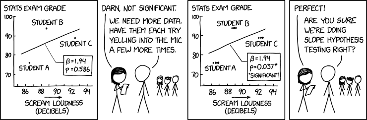

## Simpson's Paradox: A Second Key Can Reverse the Answer

- **Simpson's paradox**: a comparison that holds inside every group reverses when the groups are combined.
- **Confounder**: a variable that affects both which group a row lands in and the outcome. Here, sicker patients were more likely to get the new treatment, and sicker patients recover less often.
- **Why it happens**: the overall rate is a weighted average of the group rates, and the two treatments have different weights. New's patients were mostly severe, Standard's mostly mild.
- **What to do**: when a group comparison drives a decision, also group by the likely confounder (severity, age, department, visit type) and compare within each level.

This `trial` table holds one row per severity and treatment, with patient and recovery counts:

|  | severity | treatment | patients | recovered |
| --- | --- | --- | --- | --- |
| 0 | Mild | Standard | 80 | 64 |
| 1 | Mild | New | 20 | 18 |
| 2 | Severe | Standard | 20 | 6 |
| 3 | Severe | New | 80 | 32 |

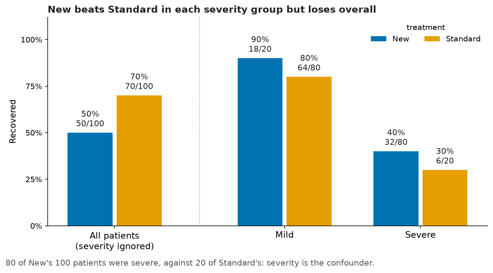

### Code Snippet: Recovery by Treatment, Then Within Severity

```python
one_key = trial.groupby('treatment')[['patients', 'recovered']].sum()
one_key['rate'] = one_key['recovered'] / one_key['patients']
display(one_key)

two_keys = trial.groupby(['severity', 'treatment'])[['patients', 'recovered']].sum()
two_keys['rate'] = two_keys['recovered'] / two_keys['patients']
display(two_keys['rate'].unstack())
```

| treatment | patients | recovered | rate |
| --- | --- | --- | --- |
| New | 100 | 50 | 0.5 |
| Standard | 100 | 70 | 0.7 |

| severity | New | Standard |
| --- | --- | --- |
| Mild | 0.9 | 0.8 |
| Severe | 0.4 | 0.3 |

Grouped by treatment alone, New loses (0.5 against 0.7); within each severity level, New wins by 0.1. Sum the counts before dividing: averaging New's two severity rates gives 0.65, which ignores that 80 of its 100 patients were severe.

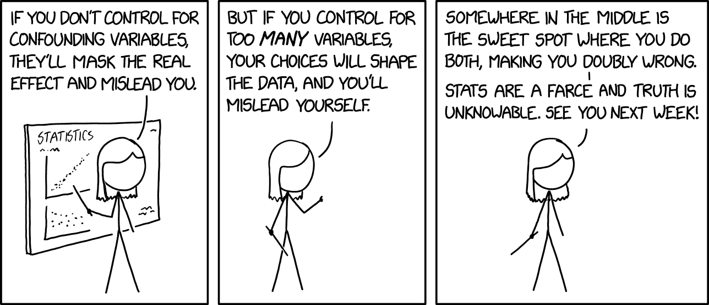

# Pivot Tables and Cross-Tabulations

- **Pivot table** (`pivot_table`): the two-key `groupby(...).mean().unstack()` in one call, and the shape of most handed-off reports, departments down the side and clinics across. A **crosstab** counts the rows in each combination.
- **Margins** (`margins=True`) add a `Total` row and column computed from the underlying rows. Use them for totals; never average a row of cell means by hand, because each cell covers a different number of visits.
- `fill_value=0` belongs only in counts and sums, where an absent cell truly is 0; a mean with no rows stays `NaN`.


## Pivot Table Review

### Reference Card: Pivot Tables and Crosstabs

- `pd.pivot_table(df, values=..., index=..., columns=..., aggfunc='mean')`: One summary per cell; `aggfunc=['sum', 'mean']` gives several; absent cells are `NaN`.
- `margins=True, margins_name='Total'`, `fill_value=0`: Totals computed from the rows; zeros for absent count or sum cells. `pd.crosstab()` takes the same options.
- `pd.crosstab(df['a'], df['b'])`: Counts per combination; `normalize='index'` turns each row into shares that sum to 1, and `values=df['v'], aggfunc='mean'` summarizes a third column.


# LIVE DEMO!

[Open Demo 1 in Colab](https://colab.research.google.com/github/christopherseaman/datasci_217/blob/main/08/demo/demo1_groupby_operations.ipynb)

# Missing and Empty Groups

A clinic report should list every clinic, even one with no visits yet, and count every visit, even one with no clinic recorded. Two `groupby` defaults break both rules without a warning:

- Rows with a missing key are dropped before the split, so a visit with no clinic recorded goes uncounted.
- A categorical key lists only the categories that occur, so a new clinic with no visits has no row.

## Missing Keys and Unused Categories

### Reference Card: Group Coverage Options

- `df.groupby('key', dropna=False)`: Keep rows with a missing key as a `NaN` group, listed last. The default, `dropna=True`, leaves them out.
- `pd.Categorical(values, categories=[...], ordered=True)`: Sets the allowed clinics and their reporting order; groups follow it, not alphabetical order.
- `df.groupby('key', observed=False)`: For a categorical key, list every defined category; an unused one shows 0 for counts and sums and `NaN` for means. The pandas 3 default, `observed=True`, lists only categories present.
- `pd.pivot_table(..., observed=False, dropna=False)`: The same two choices for a pivot table's rows and columns.

### Code Snippet: Every Clinic and Every Visit

```python
report = visits.copy()
report.loc[5, 'clinic'] = None     # East's only visit has no clinic recorded
report['clinic'] = pd.Categorical(report['clinic'], categories=['North', 'South', 'East', 'West'], ordered=True)
display(report.groupby('clinic')['wait_min'].count())
display(report.groupby('clinic', observed=False, dropna=False)['wait_min'].count())
```

| clinic | wait_min |
| --- | --- |
| North | 3 |
| South | 2 |

| clinic | wait_min |
| --- | --- |
| North | 3 |
| South | 2 |
| East | 0 |
| West | 0 |
| NaN | 1 |

The default report counts five of six visits and lists two of four clinics, with nothing to say so. The second lists every clinic in reporting order and the unrecorded visit as its own `NaN` row.

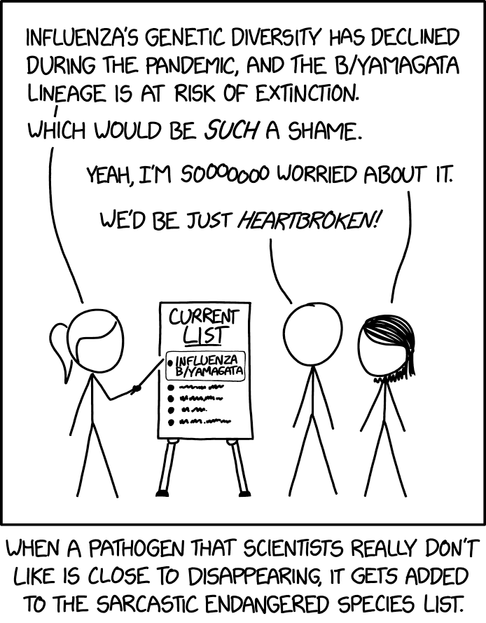

# Beyond Aggregation: transform, filter, and apply

Aggregation returns one row per group. Three other methods also run on each group's rows, but return rows of the original table instead:

- `transform` returns one value for every original row, so a group statistic can sit beside each visit.
- `filter` returns the original rows of the groups that pass a test.
- `apply` returns whatever your function returns for each group, such as each clinic's top two rows.

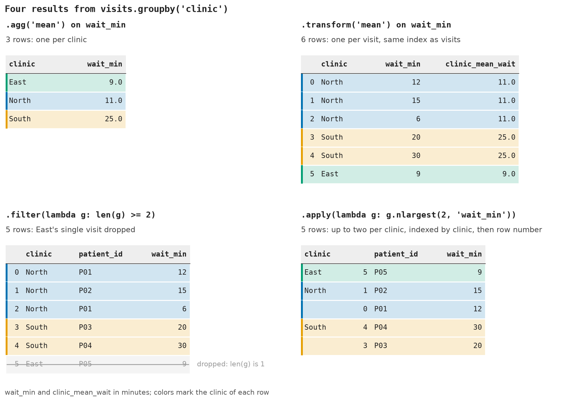

- Use `agg`, `transform`, or `filter` whenever one fits; a single number such as the longest wait is just `agg('max')`.

## Transform Operations

- **transform**: computes a statistic for each group and copies it back to every row of that group. The result has the table's length and index, so it can become a new column.
- **Where it comes up**: comparing each lab value with the patient's own average, flagging waits far above their clinic's usual, and filling a missing value from its own clinic.
- **z-score**: `(value - group_mean) / group_std`, a row's distance from its group's mean in standard deviations; 0 is the mean, 1 is one standard deviation above it. A one-row group has no standard deviation, so its z-score is `NaN`; keep it missing.
- **Group-specific fill**: `fillna()` with each group's own median keeps one clinic's typical value from filling another clinic's gaps.

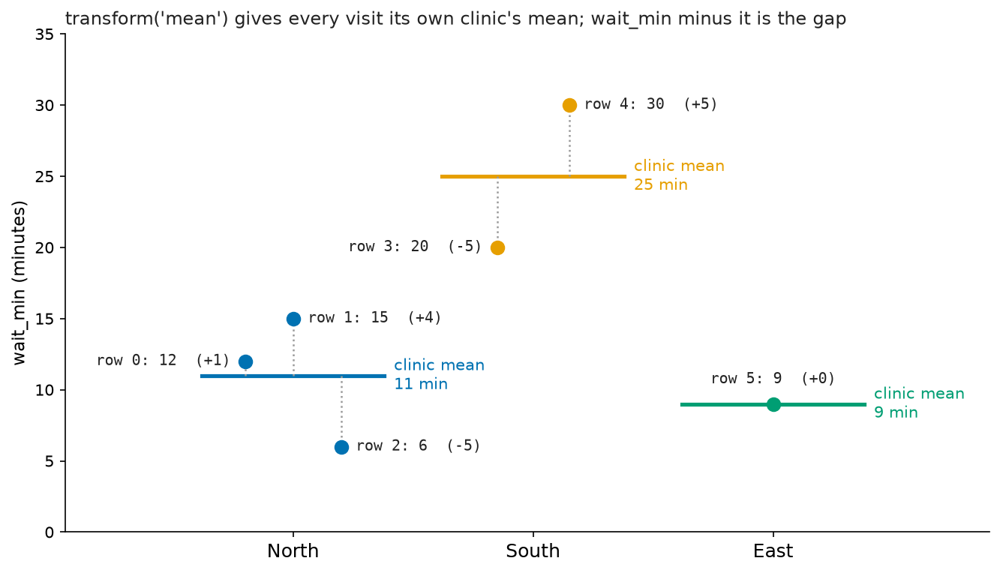

### Reference Card: Transform Operations

| Call | Purpose and key arguments | Output |
| :--- | :--- | :--- |
| `grouped.transform('mean')` | Broadcast each group's mean to its original rows | Series aligned to original index |
| `grouped.transform('std')` | Broadcast within-group spread | Series aligned to original index |
| `grouped.transform(lambda x: x - x.mean())` | Compute a custom within-group value | Same row count as input |
| `df['col'].fillna(df.groupby('key')['col'].transform('median'))` | **Group-specific fill**: replace each missing value with its own group's median | Series aligned to original index |

### Code Snippet: Compare Each Visit with Its Clinic

```python
with_context = visits.copy()   # visits itself stays unchanged
with_context['clinic_mean_wait'] = visits.groupby('clinic')['wait_min'].transform('mean')
with_context['wait_vs_clinic'] = with_context['wait_min'] - with_context['clinic_mean_wait']
display(with_context[['clinic', 'patient_id', 'wait_min', 'clinic_mean_wait', 'wait_vs_clinic']])
```

|  | clinic | patient_id | wait_min | clinic_mean_wait | wait_vs_clinic |
| --- | --- | --- | --- | --- | --- |
| 0 | North | P01 | 12 | 11.0 | 1.0 |
| 1 | North | P02 | 15 | 11.0 | 4.0 |
| 2 | North | P01 | 6 | 11.0 | -5.0 |
| 3 | South | P03 | 20 | 25.0 | -5.0 |
| 4 | South | P04 | 30 | 25.0 | 5.0 |
| 5 | East | P05 | 9 | 9.0 | 0.0 |

East's one visit sits exactly at its clinic's mean: it is easy to be average when you are the whole group.

<callout icon="⚠️" color="yellow_bg">
	## New column from a group statistic: use `transform`
	`visits['clinic_mean'] = visits.groupby('clinic')['wait_min'].mean()` fills the column with `NaN`: the summary has one row per clinic, the table one row per visit. Adding `.values` raises `ValueError: Length of values (3) does not match length of index (6)`. `transform('mean')` returns one value per visit.
</callout>

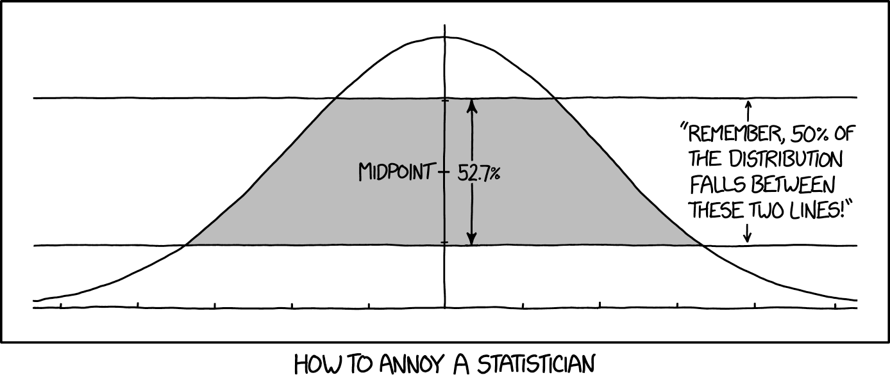

## Filter Operations

- **filter**: runs a test on each whole group and keeps every original row of the groups that pass. Rows are kept or dropped, never changed.
- A boolean mask such as `visits[visits['wait_min'] > 10]` tests each row; `filter` tests each group.
- **Where it comes up**: public reports of patient data often hide any group with 10 or fewer patients (the CMS cell-size rule), and `filter(lambda g: g['patient_id'].nunique() >= 11)` drops those groups before the report is built.

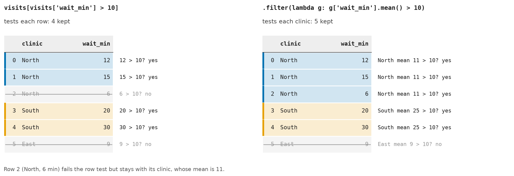

### Reference Card: Filter Operations

| Call | Purpose and key arguments | Output |
| :--- | :--- | :--- |
| `grouped.filter(lambda g: len(g) >= n)` | Keep groups with at least `n` rows | Original rows from passing groups |
| `grouped.filter(lambda g: g['col'].sum() > threshold)` | Keep groups meeting a total threshold | Original rows from passing groups |
| `grouped.filter(lambda g: g['col'].mean() > threshold)` | Keep groups meeting a mean threshold | Original rows from passing groups |

### Code Snippet: Keep Clinics by Size, Mean, or Total

```python
busy = visits.groupby('clinic').filter(lambda g: len(g) >= 2)
slow = visits.groupby('clinic').filter(lambda g: g['wait_min'].mean() > 10)
heavy = visits.groupby('clinic').filter(lambda g: g['wait_min'].sum() > 40)
display(slow[['clinic', 'patient_id', 'wait_min']])
print(len(busy), heavy['clinic'].unique().tolist())
```

|  | clinic | patient_id | wait_min |
| --- | --- | --- | --- |
| 0 | North | P01 | 12 |
| 1 | North | P02 | 15 |
| 2 | North | P01 | 6 |
| 3 | South | P03 | 20 |
| 4 | South | P04 | 30 |

```text
5 ['South']
```

East (one visit, mean 9) fails both the size and the mean test. Only South's waits total more than 40 minutes (North's add up to 33). The row mask `visits[visits['wait_min'] > 10]` would instead drop North's 6-minute visit; `filter` keeps it, because North as a whole passes.

## Apply: Your Own Function per Group

- **apply**: hands each group to your function as a small DataFrame and stitches the results together. The result can be a number, a summary, or several original rows, so its shape depends on what your function returns. It is the slower fallback: use it when no built-in aggregation fits.
- **Where it comes up**: each patient's two most recent lab results, or each clinic's longest waits for a quality review.

### Reference Card: Apply Operations

| Call | Purpose and key arguments | Output |
| :--- | :--- | :--- |
| `grouped.apply(func, include_groups=False)` | Run your own function on each group's columns, excluding the grouping column | Depends on `func` |
| `grouped.apply(lambda g: g.sort_values('col'), include_groups=False)` | Sort rows inside each group | Every row, grouped and sorted |
| `df.nlargest(n, 'col')` | The `n` rows with the largest values in `col`, largest first; ties keep their original order | Up to `n` rows |
| `grouped.apply(lambda g: g.nlargest(2, 'col'), include_groups=False)` | Keep the top two rows in each group | Up to two rows per group |
| `df.sort_values('col', ascending=False).groupby('key').head(2)` | The same top two rows without `apply`; `.tail(1)` after an ascending date sort keeps each patient's latest row | Up to two rows per group, original flat index |

### Code Snippet: Keep the Two Longest Waits at Each Clinic

```python
top2 = visits.groupby('clinic').apply(
    lambda g: g.nlargest(2, 'wait_min'), include_groups=False,
)
display(top2[['patient_id', 'wait_min']])
```

| clinic |  | patient_id | wait_min |
| --- | --- | --- | --- |
| East | 5 | P05 | 9 |
| North | 1 | P02 | 15 |
|  | 0 | P01 | 12 |
| South | 4 | P04 | 30 |
|  | 3 | P03 | 20 |

- The index has two levels (a MultiIndex): the clinic, then each visit's original row number.
- East keeps its single visit because `nlargest(2)` returns as many rows as the group has.
- In pandas 3, `include_groups=False` is the default and the only allowed value, so your function never receives the clinic column; writing it out keeps the code working on pandas 2.2.

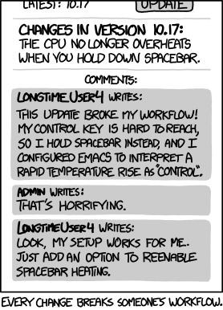

# LIVE DEMO!

[Open Demo 2 in Colab](https://colab.research.google.com/github/christopherseaman/datasci_217/blob/main/08/demo/demo2_coverage_result_shapes.ipynb)

# Performance Optimization

- **Performance optimization**: making an analysis run faster or use less memory, which matters once a summary that takes a second on a class example takes minutes on a year of hospital lab results.
- One `.agg()` call computing several summaries beats calling `groupby()` again for each summary, because every new `groupby()` call redoes the split.
- Built-in aggregations named by string (`'mean'`, `'std'`, `transform('mean')`) run as fast compiled code; a Python `lambda` or `apply` runs once per group. On 118,645 A1c results from 90,178 patients, a lambda was about 1,400 times slower for a standard deviation and thousands of times slower for a transform.
- A repeated text key stored as `category` uses far less memory.

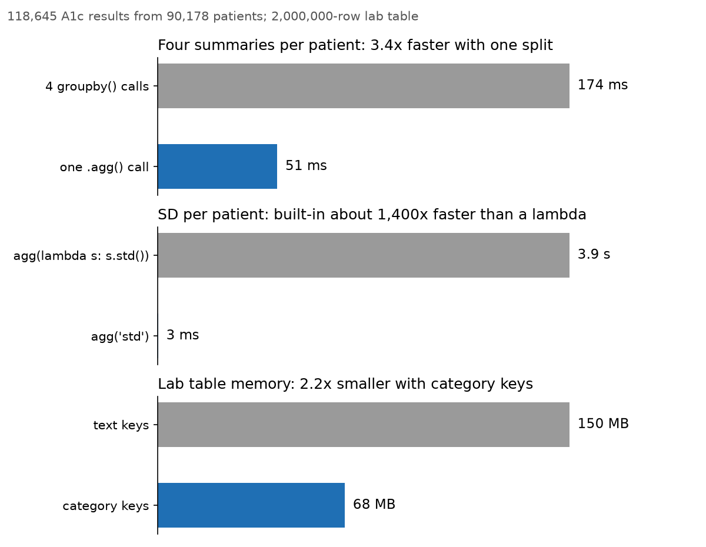

## Measuring Speed and Memory

### Reference Card: Measure Before Optimizing

- `%timeit expression`: Time one line in a notebook by running it many times; output looks like `48 ms ± 581 μs per loop (mean ± std. dev. of 7 runs, 10 loops each)`.
- `df.memory_usage(deep=True)`: Bytes used by each column, counting the text inside it; shows which column to shrink.
- `df['key'].astype('category')`: Store a repeated text key as a few labels plus a small code per row; same groups, less memory.
- `grouped['col'].agg(['mean', 'std', 'count'])`: Several summaries from one split instead of one `groupby()` per summary.

### Code Snippet: Time One Split and Shrink a Text Key

`labs` holds 2,000,000 synthetic lab results (`patient_id`, `clinic`, `test_name`, `result`) from eight clinics, and `a1c` holds its 118,645 A1c results with a value, from 90,178 patients; timings depend on the machine.

```python
%timeit [a1c.groupby('patient_id')['result'].agg(f) for f in ['count', 'mean', 'std', 'max']]
%timeit a1c.groupby('patient_id')['result'].agg(['count', 'mean', 'std', 'max'])
print(labs['clinic'].memory_usage(deep=True) / 1e6)
print(labs['clinic'].astype('category').memory_usage(deep=True) / 1e6)
```

```text
165 ms ± 580 μs per loop (mean ± std. dev. of 7 runs, 2 loops each)
48.8 ms ± 760 μs per loop (mean ± std. dev. of 7 runs, 5 loops each)
30.427492
2.000258
```

One split is about 3.4 times faster than four. The text `clinic` column takes 30.4 MB; as a category, 2.0 MB.

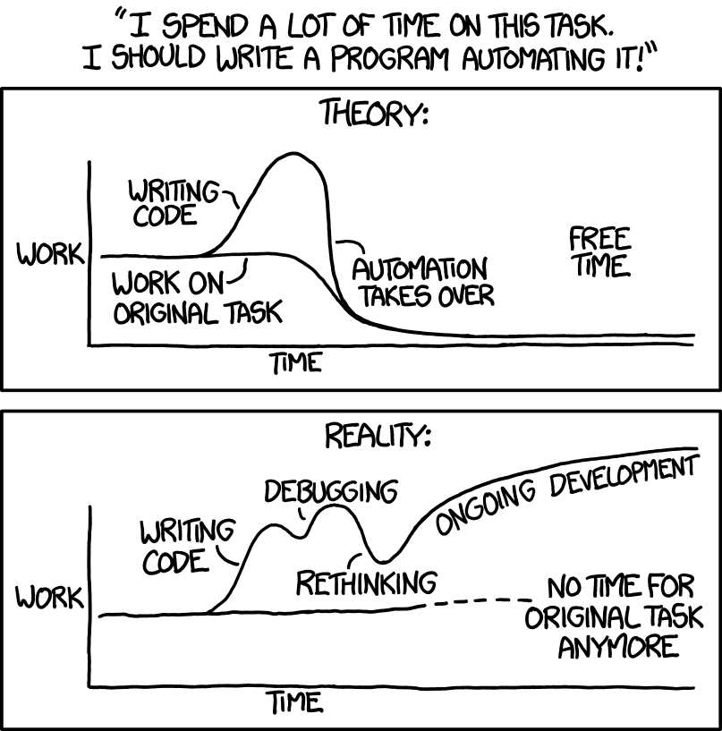

# Terminal Sessions with tmux

- **Terminal multiplexer**: a program such as `tmux` that runs shells inside a **session** that keeps going on its own. You **detach** from it, close the terminal, and **attach** again later to find the job still running.
- It works on your laptop or on a server: locally it keeps a long job going after you close the terminal window, and over SSH it survives a dropped connection. A session does not survive a restart of the machine it runs on.
- `screen` is an older alternative; use whichever the machine provides.

```text
terminal (laptop, or over ssh) ──> tmux session "analysis"   (keeps running after you detach)
                                     └─ python3 analysis.py
```

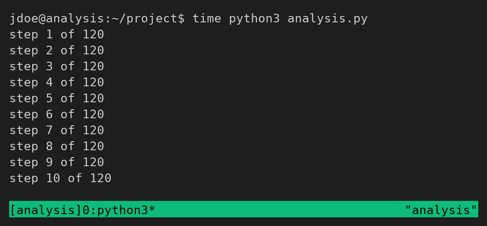

## Sessions, Windows, and Panes

### Reference Card: tmux Commands

Every shortcut starts with the **prefix**, `Ctrl+b`: press it, release, then press the next key.

| Task | Command or keys | Result |
| :--- | :--- | :--- |
| Install | `brew install tmux` (macOS), `sudo apt install tmux` (Ubuntu or WSL); `tmux -V` | Version such as `tmux 3.6`; servers usually have it |
| Start | `tmux new -s analysis` | New session named `analysis`, status bar at the bottom |
| Detach | `Ctrl+b`, then `d` | Back at the normal prompt; the session keeps running |
| List | `tmux ls` | `analysis: 1 windows (created ...)`, or `no server running` when none exist |
| Reattach | `tmux attach -t analysis` | The session, exactly as you left it |
| New window | `Ctrl+b`, then `c`; switch with `Ctrl+b`, then `n` (next) or `p` (previous) | A second shell in the same session |
| Split | `Ctrl+b`, then `%` (side by side) or `"` (stacked); move with `Ctrl+b`, then an arrow key | Two shells on one screen |
| Scroll | `Ctrl+b`, then `[`; arrow keys or Page Up; `q` to leave | Read output that scrolled off the screen |
| End | `exit` inside the session, or `tmux kill-session -t analysis` from outside | Session closed, stopping anything still running in it |
| screen | `screen -S analysis`; detach `Ctrl+a`, then `d`; `screen -r analysis` | The same idea with `screen` |

### Code Snippet: Keep an Analysis Running

In a project folder whose environment you built with `uv venv --seed` and `uv sync`, on your laptop or after `ssh`:

```bash
tmux new -s analysis
source .venv/bin/activate
time python3 analysis.py
```

Press `Ctrl+b`, then `d`, to detach; now it is safe to close the terminal or disconnect. Later, find the session and attach to it; when the job ends, `time` reports how long it ran:

```bash
tmux ls
tmux attach -t analysis
```


# Remote Computing with SSH

- **SSH** (Secure Shell): opens an encrypted terminal on another computer, a **server** or **host**, so you can run analyses too large or too long for a laptop.
- **Protected health information** (PHI), records that can identify a person, often may not leave an approved secure server, so you bring your code to the data and take back only permitted results.

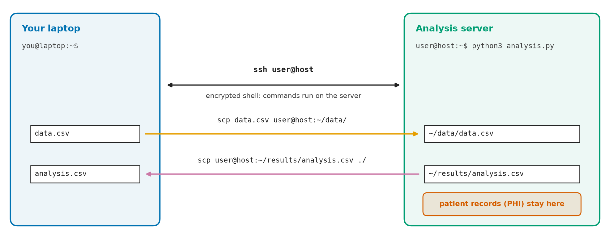

## Connect and Copy Files

The server's operator supplies its hostname, your account, and how to log in. Once connected, shell commands (`pwd`, `ls`, `cd`, `python3`) run on the server, and the prompt shows where you are; `exit` returns to your laptop:

```text
you@laptop:~$ ssh jdoe@analysis.example.org
The authenticity of host 'analysis.example.org' can't be established.
ED25519 key fingerprint is SHA256:...
Are you sure you want to continue connecting (yes/no/[fingerprint])? yes
jdoe@analysis:~$ hostname
analysis
jdoe@analysis:~$ exit
you@laptop:~$
```

- **Host key fingerprint**: the code shown on your first connection that identifies the server. Type `yes` only if it matches the fingerprint the administrator published; SSH remembers the server after that.
- A password prompt shows nothing as you type; that is normal.

### Reference Card: Connect and Copy

| Command | Purpose and key arguments | Result |
| :--- | :--- | :--- |
| `ssh user@host` | Open a remote shell; `exit` returns | Remote prompt |
| `ssh -p port user@host` | Connect through a nondefault port | Remote prompt |
| `ssh user@host 'command'` | Run one command remotely | Command output locally |
| `scp local user@host:path` | Copy a local file to the server | Remote file |
| `scp user@host:path local` | Copy a remote file back | Local file |
| `gh codespace ssh --config >> ~/.ssh/config` | Write an SSH entry for each of your GitHub Codespaces, a cloud machine you can practice on | Plain `ssh` and `scp` reach the codespace by the name it prints |

### Code Snippet: Upload a File and Download a Result

Run these from your laptop's prompt, not inside an `ssh` session. The first copies `data.csv` into the server's existing `~/data/` folder; the second copies `analysis.csv` into your current local folder:

```bash
scp data.csv jdoe@analysis.example.org:~/data/
scp jdoe@analysis.example.org:~/results/analysis.csv ./
```

## SSH Keys

- **SSH key pair**: what most servers use instead of a password. `ssh-keygen` creates the **public key**, `~/.ssh/id_ed25519.pub`, a padlock you install on every server you use, and the **private key**, `~/.ssh/id_ed25519`, the only key that opens it.
- **SSH agent**: a background program on your laptop (macOS runs one for you) that keeps an unlocked private key in memory, so `ssh` and `scp` stop asking for the passphrase.

<callout icon="⚠️" color="yellow_bg">
	## Never share your private key
	Never email, upload, or commit `~/.ssh/id_ed25519`: anyone holding it can log in as you. Only the `.pub` file goes to servers.
</callout>

### Reference Card: SSH Keys

| Command | Purpose and key arguments | Result |
| :--- | :--- | :--- |
| `ssh-keygen -t ed25519` | Create a public/private key pair; `-C "email"` labels it | `~/.ssh/id_ed25519` and `~/.ssh/id_ed25519.pub` |
| `ssh-keygen -t ed25519 -f path` | Save the pair at `path` instead of the default, such as a practice key that must not replace your real one | `path` and `path.pub` |
| `ssh-copy-id user@host` | Install the public key where supported | Passwordless key login |
| `ssh-add` | Unlock your private key once per login session; the SSH agent keeps it unlocked | Later `ssh` and `scp` stop asking for the passphrase |

### Code Snippet: Create a Key Pair

Run this once on your laptop, then install only the public half using the server's instructions or `ssh-copy-id`:

```bash
ssh-keygen -t ed25519 -C "your_email@example.com"
```

- Press Enter for the default location, and set a passphrase that protects the private key file.
- `ssh-add` asks for the passphrase once, and the agent keeps the key unlocked until you log out. If `ssh-add` cannot connect to your authentication agent (common in WSL), skip it and type the passphrase when asked.
- `Overwrite (y/n)?` means a key already exists: answer `n` and keep using it, because replacing it breaks access to servers that trust its public half.

# LIVE DEMO!

[Open Demo 3 in Colab](https://colab.research.google.com/github/christopherseaman/datasci_217/blob/main/08/demo/demo3_remote_performance.ipynb)
