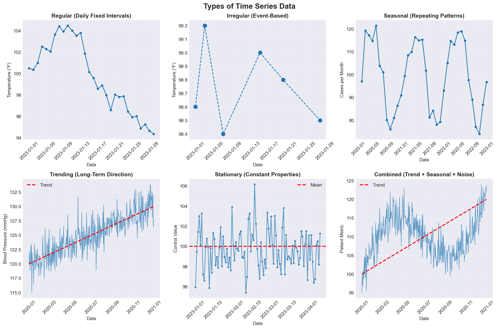
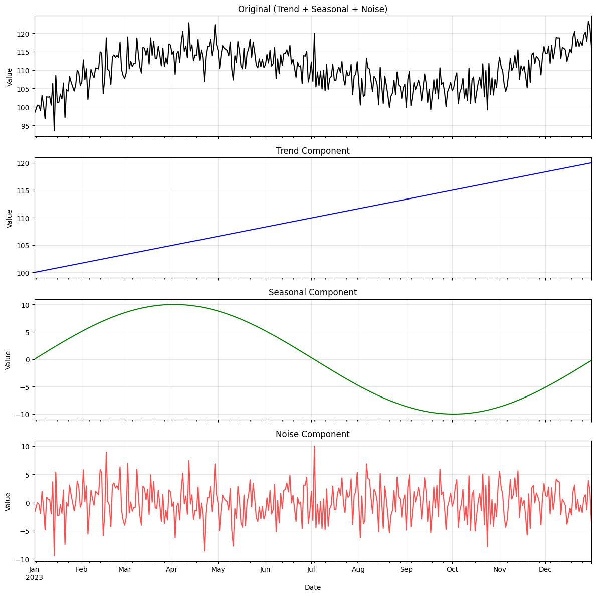
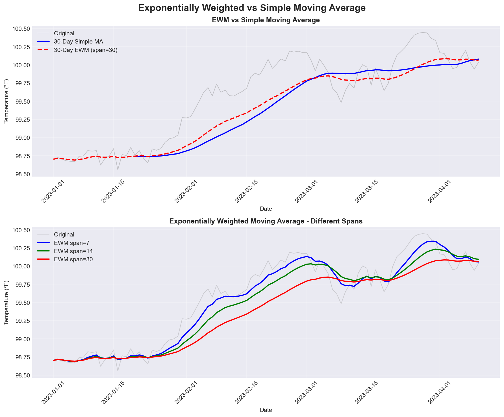

---
notion:
  title_line: "# DLC: Advanced Time Series Analysis Topics"
  role: bonus
  status: mapped
  page_id: "3d2d9fdd-1a1a-8164-a3f7-c5c5d3a8617a"
  url: "https://app.notion.com/p/3d2d9fdd1a1a8164a3f7c5c5d3a8617a"
---

# DLC: Advanced Time Series Analysis Topics

Everything in this document is optional for Lecture 09. It collects specialized material on periods, time-series patterns and decomposition, forecasting, more window options, high-frequency data, custom frequencies, advanced time zones, and additional visualization.

The forecasting and stationarity tools below are specialized reference. Lecture 10 teaches the general prediction workflow, including temporal splits and feature availability; it does not require these dedicated time-series models.

The decomposition, forecasting, and autocorrelation examples use `statsmodels`, and the interactive plot uses `plotly`. Colab includes both, but the course environment does not: add them to a project with `uv add statsmodels plotly` (Lecture 03).

# Period Arithmetic and Fiscal Year Handling

_Periods represent time spans, not specific moments: a fiscal quarter, a billing month, a reporting year._

## Period Basics

A **fiscal year** is an organization's reporting year, which may end outside December. Many US hospitals run July through June: `Y-JUN` names a year by the June it ends in, so fiscal 2025 runs July 2024 through June 2025, and `Q-JUN` makes July to September its Q1. Budget, volume, and quality reports to a hospital board use these labels.

### Reference Card: Period Creation and Arithmetic

| Function | Description |
|----------|-------------|
| `pd.Period('2025', freq='Y-JUN')` | Fiscal year ending June 2025 |
| `pd.Period('2025Q1', freq='Q-JUN')` | First quarter of that fiscal year (July to September 2024) |
| `period + 1` | Next period of the same frequency |
| `pd.period_range(start, end, freq='M')` | Create a range of monthly periods |
| `period.asfreq('D', how='start')` | Convert to another frequency; `how` picks the start or end |
| `period.start_time`, `period.end_time` | First and last instant of the span |
| `period.to_timestamp()` | Convert a period to a timestamp |

### Code Snippet: Fiscal Years and Quarters for ED Volume

```python
fy = pd.Period('2025', freq='Y-JUN')
print(f"FY2025: {fy.start_time:%Y-%m-%d} to {fy.end_time:%Y-%m-%d}")
print(f"Plus 1 year: {fy + 1}, minus 2 years: {fy - 2}")

q1 = pd.Period('2025Q1', freq='Q-JUN')
print(f"FY2025 Q1: {q1.asfreq('D', how='start')} to {q1.asfreq('D', how='end')}")

ed_visits = pd.Series([4120, 3980, 4310, 4550, 4890, 5020],
                      index=pd.period_range('2024-07', '2024-12', freq='M'))
print(ed_visits)
print(ed_visits.index.asfreq('Q-JUN'))  # fiscal quarter of each month
```

```text
FY2025: 2024-07-01 to 2025-06-30
Plus 1 year: 2026, minus 2 years: 2023
FY2025 Q1: 2024-07-01 to 2024-09-30
2024-07    4120
2024-08    3980
2024-09    4310
2024-10    4550
2024-11    4890
2024-12    5020
Freq: M, dtype: int64
PeriodIndex(['2025Q1', '2025Q1', '2025Q1', '2025Q2', '2025Q2', '2025Q2'], dtype='period[Q-JUN]')
```

Calendar 2024 Q3 is fiscal 2025 Q1: the same three months, two labels.

## Converting Between Timestamps and Periods

Converting a timestamp to a period keeps the containing span, not the original instant. Converting back chooses its start by default; `how='end'` chooses its final instant. Multiple dates can become the same monthly period, so conversion alone does not produce a monthly summary.

### Reference Card: Timestamp-Period Conversion

| Function | Description |
|----------|-------------|
| `ts.to_period()` | Convert timestamp index to periods |
| `ts.to_period('M')` | Convert to monthly periods |
| `pts.to_timestamp()` | Convert periods back to timestamps |
| `pts.to_timestamp(how='end')` | Use end of period as timestamp |

### Code Snippet: Month-End Claims Totals as Billing Months

Paid claims, in thousands of dollars, arrive stamped with each month's last day.

```python
claims = pd.Series([812.4, 790.1, 845.9],
                   index=pd.date_range('2024-01-31', periods=3, freq='ME'))
monthly = claims.to_period()
print(monthly)
print(monthly.to_timestamp())
```

```text
2024-01    812.4
2024-02    790.1
2024-03    845.9
Freq: M, dtype: float64
2024-01-01    812.4
2024-02-01    790.1
2024-03-01    845.9
Freq: MS, dtype: float64
```

The round trip moves each label from month end to month start. A join against a table keyed on month-end dates now misses every row, so keep the period label for monthly joins.

# Advanced Time Series Decomposition

_Decomposition separates time series into trend, seasonal, and residual components, revealing underlying patterns._

## Patterns in a Time Series

The lecture sorts series by spacing, regular or irregular. A series can also be described by the pattern its values follow, and decomposition pulls those patterns apart.



| Pattern | Description | Example |
| --- | --- | --- |
| **Seasonal** | Patterns repeat over time | Monthly flu case counts |
| **Trending** | Long-term direction | Long-term blood pressure trends |
| **Stationary** | Statistical properties don't change | Laboratory control measurements |
| **Combined** | Multiple components (trend + seasonal + noise) | Real-world medical data with all patterns |

## Seasonal Decomposition

- **Trend**: the slow change in the level; **seasonality**: a repeating cycle; **residual**: what remains after those components are removed.
- **Additive**: observed = trend + seasonal + residual; seasonal swings have roughly constant size. **Multiplicative**: observed = trend × seasonal × residual; swings grow with the level, and all values must be positive.
- `period` counts observations per cycle: 7 for a weekly cycle in daily data, 12 for an annual cycle in monthly data. Use regular spacing, no missing values, and at least two complete cycles.



### Reference Card: Seasonal Decomposition

```python
from statsmodels.tsa.seasonal import seasonal_decompose

# Decompose a Series `ts` with a DatetimeIndex
decomposition = seasonal_decompose(ts, model='additive', period=7)
# or
decomposition = seasonal_decompose(ts, model='multiplicative', period=12)

# Access components
decomposition.observed  # Original series
decomposition.trend     # Trend component
decomposition.seasonal  # Seasonal component
decomposition.resid     # Residual component
```

### Code Snippet: Decompose Daily ILI Visits

```python
import pandas as pd
import numpy as np
import matplotlib.pyplot as plt
from statsmodels.tsa.seasonal import seasonal_decompose

rng = np.random.default_rng(42)

# Daily influenza-like illness (ILI) visits over 3 years: growing catchment, winter peak
dates = pd.date_range('2020-01-01', periods=365*3, freq='D')
trend = np.linspace(100, 200, len(dates))
seasonal = 10 * np.cos(2 * np.pi * np.arange(len(dates)) / 365.25)
noise = rng.normal(0, 5, len(dates))
ili_visits = pd.Series(trend + seasonal + noise, index=dates)

decomposition = seasonal_decompose(ili_visits, model='additive', period=365)

# Plot decomposition
fig, axes = plt.subplots(4, 1, figsize=(15, 12))
decomposition.observed.plot(ax=axes[0], title='Original')
decomposition.trend.plot(ax=axes[1], title='Trend')
decomposition.seasonal.plot(ax=axes[2], title='Seasonal')
decomposition.resid.plot(ax=axes[3], title='Residual')
plt.tight_layout()
plt.show()
```

The panels show a rising trend, a winter wave each year, and the remaining noise. A surveillance team reads an outbreak as a run of large positive residuals, since the trend and the usual winter rise are already removed. The default centered trend uses future observations and leaves gaps at the ends; these components describe a completed series, not features available in real time.

## STL Decomposition

**STL** separates seasonality and trend using local smoothing: curves fitted to nearby observations. `robust=True` reduces the influence of extreme values; it does not make the result safe for prediction-time features. Here `period=365` approximates the annual cycle of daily data.

### Reference Card: STL Decomposition

```python
from statsmodels.tsa.seasonal import STL

# STL decomposition; one holiday surge should not bend the trend
# `period` is the known number of observations per cycle (annual here).
# `seasonal` is the odd length of STL's seasonal smoother, not the period.
stl = STL(ili_visits, period=365, seasonal=13, robust=True)
result = stl.fit()

# Access components
result.observed  # Original series
result.trend     # Trend component
result.seasonal  # Seasonal component
result.resid     # Residual component
```

# Time Series Forecasting

_Forecasting uses historical patterns to predict future values. A staffing office plans nurses for the upper end of the forecast interval, so report the interval with the point forecast._

## ARIMA Models

**ARIMA** combines past values (**autoregression**, `p`), repeated differences to remove changes in level (**integration**, `d`), and past prediction errors (**moving average**, `q`). `order=(1, 1, 1)` is an example, not a rule for every series. Fit on the earlier chronological block and assess forecasts on later observations: below, the model trains on all but the last 30 days of ILI visits and forecasts those 30.

The **augmented Dickey-Fuller (ADF) test** asks whether the series has a unit root, a source of persistent drift. A small p-value rejects that particular explanation; it does not prove every property is stationary or establish forecast accuracy. Use a nonconstant numeric series with no missing values.

### Reference Card: ARIMA Models and Stationarity Checks

```python
from statsmodels.tsa.arima.model import ARIMA
from statsmodels.tsa.stattools import adfuller

# Check stationarity
def check_stationarity(series):
    """Report the ADF test against the unit-root null hypothesis."""
    result = adfuller(series)
    print(f'ADF Statistic: {result[0]}')
    print(f'p-value: {result[1]}')
    
    if result[1] <= 0.05:
        print("Reject the unit-root null: evidence supports stationarity")
    else:
        print("Fail to reject the unit-root null: result is inconclusive")

# Fit ARIMA model
def fit_arima(series, order=(1, 1, 1)):
    """Fit ARIMA model"""
    model = ARIMA(series, order=order)
    fitted_model = model.fit()
    
    # Forecast
    forecast = fitted_model.forecast(steps=30)
    forecast_ci = fitted_model.get_forecast(steps=30).conf_int()
    
    return fitted_model, forecast, forecast_ci

train, test = ili_visits.iloc[:-30], ili_visits.iloc[-30:]
check_stationarity(train)
model, forecast, forecast_ci = fit_arima(train)
mae = (test - forecast).abs().mean()  # mean absolute error, visits per day
```

statsmodels 0.15 prints a `FutureWarning` about `adfuller`'s return type; it does not change `result[0]` or `result[1]`.

## Exponential Smoothing

These forecasting models extend a smoothed level with a trend (Holt) or trend and seasonality (Holt-Winters). Here `ili_visits` is the daily series from the decomposition example; its annual cycle is approximately 365 observations. A monthly series would use `seasonal_periods=12`. Forecast steps count observations, so 30 steps here means 30 days. The examples use fixed smoothing coefficients of 0.3 (`optimized=False`), chosen for illustration rather than forecast accuracy.

### Reference Card: Exponential Smoothing Variants

```python
from statsmodels.tsa.holtwinters import ExponentialSmoothing

# Simple exponential smoothing
model = ExponentialSmoothing(ili_visits, trend=None, seasonal=None)
fitted = model.fit(smoothing_level=0.3, optimized=False)
forecast = fitted.forecast(steps=30)

# Holt's method (trend)
model = ExponentialSmoothing(ili_visits, trend='add', seasonal=None)
fitted = model.fit(smoothing_level=0.3, smoothing_trend=0.3, optimized=False)
forecast = fitted.forecast(steps=30)

# Holt-Winters (trend + seasonal)
model = ExponentialSmoothing(ili_visits, trend='add', seasonal='add', seasonal_periods=365)
fitted = model.fit(smoothing_level=0.3, smoothing_trend=0.3, smoothing_seasonal=0.3, optimized=False)
forecast = fitted.forecast(steps=30)
```

# Advanced Resampling Operations

_Resampling a period index rolls monthly clinic volumes into years, or spreads an annual figure back over quarters._

## Resampling with Periods

### Reference Card: Resampling with Periods

| Function | Description |
|----------|-------------|
| `ts.to_period('M')` | Convert timestamp labels to monthly periods without aggregation |
| `ts.resample('ME').mean().to_period('M')` | Aggregate monthly, then represent labels as periods |
| `period_ts.resample('Q-DEC', convention='start')` | Upsample an annual PeriodIndex from the start of each period |

`QE` and `YE` are timestamp offset aliases used with a `DatetimeIndex`. Period frequencies describe spans and retain aliases such as `Q-DEC` and `Y-DEC`; do not substitute timestamp aliases mechanically.

### Code Snippet: Annual Volume Targets for Three Clinics

Monthly visit counts for three community clinics roll up to a mean monthly volume per year; each quarter then inherits its year's figure as a target.

```python
rng = np.random.default_rng(42)
visits = pd.DataFrame(rng.poisson([620, 410, 890], size=(24, 3)),
                      index=pd.period_range('2023-01', '2024-12', freq='M'),
                      columns=['Mission', 'Sunset', 'Bayview'])

annual = visits.resample('Y-DEC').mean()
quarterly = annual.resample('Q-DEC', convention='start').ffill()
print(annual.round(1))
print(quarterly.head().round(1))
```

```text
      Mission  Sunset  Bayview
2023    615.9   408.8    897.5
2024    621.8   404.0    880.3
        Mission  Sunset  Bayview
2023Q1    615.9   408.8    897.5
2023Q2    615.9   408.8    897.5
2023Q3    615.9   408.8    897.5
2023Q4    615.9   408.8    897.5
2024Q1    621.8   404.0    880.3
```

`ffill()` copies the annual mean into each quarter; it does not estimate quarterly volume. A clinic with a winter surge has quarters above and below its annual figure.

# More Window and Selection Options

_The lecture's rolling and EWM windows cover daily work; these options cover the rest._

## Expanding Windows, Rolling Quantiles, and Custom Functions

An **expanding window** grows from the first row to the current one, so its mean is a running average of everything so far. A rolling quantile, such as the median, moves less than a mean when one reading is wild.

### Reference Card: More Window Options

- `ts.expanding().mean()`: Running mean from the first row to the current one; no `NaN` at the start.
- `ts.rolling(window=5).quantile(0.5)`: Rolling median.
- `ts.rolling(window=5).apply(custom_func)`: Run your own function on each window's values.
- `a.rolling(30).corr(b)`: Rolling correlation between two aligned series, such as daily heart rate and blood pressure.
- `ts.ewm(alpha=0.3).mean()`: Set the decay directly instead of through `span`; larger `alpha` weights recent observations more.
- `ts.ewm(halflife=2).mean()`: Weighted mean whose weights halve every two observations.
- `ts.shift(1, freq='D')`: Move the timestamps one day later instead of the values, so nothing becomes `NaN`.
- `ts.resample('ME').agg(mean='mean', count='count')`: Named aggregation on a Series, one named column per summary.
- `ts.ewm(span=5).std()`: Exponentially weighted standard deviation.
- `ts.truncate(before='2023-06-01', after='2023-06-30')`: Drop everything outside the range (requires a sorted index).

### Code Snippet: Expanding Mean and Rolling Median

```python
import numpy as np
import pandas as pd

rng = np.random.default_rng(42)
temps = pd.Series(98.6 + np.cumsum(rng.standard_normal(100) * 0.1),
                  index=pd.date_range('2023-01-01', periods=100, freq='D'))
print(pd.DataFrame({
    'temperature': temps,
    'expanding_mean': temps.expanding().mean(),
    'rolling_median': temps.rolling(window=5).quantile(0.5),
}).head(6).round(2))
```

```text
            temperature  expanding_mean  rolling_median
2023-01-01        98.63           98.63             NaN
2023-01-02        98.53           98.58             NaN
2023-01-03        98.60           98.59             NaN
2023-01-04        98.70           98.61             NaN
2023-01-05        98.50           98.59           98.60
2023-01-06        98.37           98.55           98.53
```

# High-Frequency Data Analysis

_High-frequency data requires special handling for irregular intervals and tick data._

## Infusion Pump Event Streams

**Tick data** records an individual event or sensor reading whenever it arrives. An infusion pump logs an event at each rate change, bolus, or alarm: a minute bin can hold many events or none. `last_rate` takes the final nonmissing programmed rate, `volume_ml` adds the volume delivered, and `n_events` counts rows even when a rate is missing. Empty bins have no last rate and zero rows; their summed volume is zero by pandas' default, which a pump that was disconnected did not measure.

### Reference Card: Event Stream Aggregation

```python
import pandas as pd

def summarize_pump_events(events, freq='1min'):
    """Aggregate pump events indexed by a DatetimeIndex.

    ``events`` has ``rate_ml_h`` (programmed rate) and ``volume_ml``
    (volume delivered since the previous event). ``n_events`` counts rows
    per bin. Localize or convert the index before calling; resampling
    keeps that time basis.
    """
    if not isinstance(events.index, pd.DatetimeIndex):
        raise TypeError('events must use a DatetimeIndex')
    return events.sort_index().resample(freq).agg(
        last_rate=('rate_ml_h', 'last'),
        volume_ml=('volume_ml', 'sum'),
        n_events=('rate_ml_h', 'size'),
    )
```

Mark bins with `n_events == 0` before charting volume, so a disconnection does not read as zero delivery.

# Advanced Time Zone Operations

_Clock changes and multi-site data are where time-zone handling breaks overnight vitals and cross-site joins._

## Resolving Clock-Change Times

The lecture sets repeated (fall-back) and skipped (spring-forward) clock times to `NaT` so they can be counted and set aside. When the data carry enough context, pandas can resolve them instead.

### Reference Card: Resolving Clock-Change Times

| Argument | Effect |
|----------|--------|
| `ambiguous='infer'` | For readings in recording order that pass through the repeated hour, assign the first pass to daylight time and the second to standard time |
| `ambiguous=[True, False, ...]` | State for each reading whether it is daylight time (`True`) or standard time (`False`) |
| `nonexistent='shift_forward'` | Move a skipped time to the first valid time after the gap |

### Code Snippet: Resolve Repeated and Skipped Clock Times

```python
import pandas as pd

# Recording order preserves both passes through 01:00-01:59
fall_back = pd.DatetimeIndex(['2024-11-03 00:30', '2024-11-03 01:00', '2024-11-03 01:30',
                              '2024-11-03 01:00', '2024-11-03 01:30', '2024-11-03 02:00'])
print(fall_back.tz_localize('America/New_York', ambiguous='infer'))

# A skipped spring-forward time moved to 03:00
spring = pd.DatetimeIndex(['2024-03-10 02:30'])
print(spring.tz_localize('America/New_York', nonexistent='shift_forward'))
```

```text
DatetimeIndex(['2024-11-03 00:30:00-04:00', '2024-11-03 01:00:00-04:00',
               '2024-11-03 01:30:00-04:00', '2024-11-03 01:00:00-05:00',
               '2024-11-03 01:30:00-05:00', '2024-11-03 02:00:00-05:00'],
              dtype='datetime64[us, America/New_York]', freq=None)
DatetimeIndex(['2024-03-10 03:00:00-04:00'], dtype='datetime64[us, America/New_York]', freq=None)
```

`'infer'` relies on the readings being in recording order: it raises `ValueError` when it cannot see the clock repeat, and it can guess wrong if the rows were shuffled. Do not sort the naive wall-clock times first: that loses the order of the two passes through the repeated hour. `ambiguous='NaT'` from the lecture is the safer default.

`nonexistent='shift_forward'` changes the recorded clock time; it can put several readings at the same instant. Use it only when that correction is justified by the source system, and retain the original time for review.

## Operations Between Different Time Zones

Arithmetic aligns aware indexes by instant, even when their displayed clocks differ. An instant present in only one series produces `NaN` with ordinary arithmetic.

### Code Snippet: Compare EHR and Device Readings Across Zones

The hospital EHR in New York records clinic systolic pressure; a home-monitoring vendor in Los Angeles stamps the same patient's cuff readings in Pacific time.

```python
ehr = pd.Series([132, 128, 135, 130], name='sbp',
                index=pd.date_range('2024-03-01 09:00', periods=4, freq='D', tz='America/New_York'))
device = pd.Series([131, 133], name='sbp',
                   index=ehr.index[2:].tz_convert('America/Los_Angeles'))
print(device)
print(ehr - device)  # aligned on instants, returned in UTC
```

```text
2024-03-03 06:00:00-08:00    131
2024-03-04 06:00:00-08:00    133
Name: sbp, dtype: int64
2024-03-01 14:00:00+00:00    NaN
2024-03-02 14:00:00+00:00    NaN
2024-03-03 14:00:00+00:00    4.0
2024-03-04 14:00:00+00:00   -3.0
Name: sbp, dtype: float64
```

The 06:00 Pacific and 09:00 Eastern readings match because they are the same instant. The two EHR days without a device reading become `NaN`.

# Custom Frequency Classes

A **custom business-day frequency** follows a weekday rule plus a list of excluded holidays. Use pandas' existing `CustomBusinessDay` class to represent a clinic calendar; the example skips weekends, Christmas, and New Year's Day without defining a new class.

## Custom Business Day Frequencies

### Code Snippet: A Clinic Calendar Over the Holidays

```python
import pandas as pd
from pandas.tseries.offsets import CustomBusinessDay

clinic_day = CustomBusinessDay(holidays=['2024-12-25', '2025-01-01'])
print(pd.date_range('2024-12-23', '2025-01-03', freq=clinic_day))
```

```text
DatetimeIndex(['2024-12-23', '2024-12-24', '2024-12-26', '2024-12-27',
               '2024-12-30', '2024-12-31', '2025-01-02', '2025-01-03'],
              dtype='datetime64[us]', freq='C')
```

A follow-up call list built on `clinic_day` never schedules a call on a weekend, Christmas, or New Year's Day.

# Time Series Visualization

## Interactive Time Series Plots

Plotly adds hover labels and zoom to a line plot, useful for finding the exact day a surge began. `ili_visits` below is the three-year daily series created in the decomposition example.

### Reference Card: Interactive Time Series Plot with Plotly

```python
import plotly.graph_objects as go
from plotly.subplots import make_subplots

# Create interactive plot
fig = go.Figure()
fig.add_trace(go.Scatter(
    x=ili_visits.index,
    y=ili_visits.values,
    mode='lines',
    name='ILI visits'
))
fig.show()
```

## Autocorrelation and Partial Autocorrelation

- **Autocorrelation (ACF)**: correlation between a series and its earlier values at each lag.
- **Partial autocorrelation (PACF)**: the association at one lag after accounting for the shorter lags. Both plots help describe serial dependence; peaks alone do not identify a reliable forecasting model.
- Use the regular, nonmissing `ili_visits` series above. Forty PACF lags need more than 80 observations. Its trend can cause high correlations even without useful short-term predictability.

### Reference Card: ACF and PACF Plots

```python
import matplotlib.pyplot as plt
from statsmodels.graphics.tsaplots import plot_acf, plot_pacf

# Plot ACF and PACF
fig, axes = plt.subplots(2, 1, figsize=(12, 8))
plot_acf(ili_visits, lags=40, ax=axes[0])
plot_pacf(ili_visits, lags=40, ax=axes[1])
plt.tight_layout()
plt.show()
```

# Calendar Schedule Examples

## Code Snippet: Date Ranges

```python
print(pd.date_range('2024-01-01', '2024-01-04', freq='D'))    # daily symptom diary
print(pd.bdate_range('2024-01-05', '2024-01-09'))             # weekday clinic days
print(pd.date_range('2024-01-01', periods=3, freq='W-MON'))   # Monday check-ins
print(pd.date_range('2024-01-01', periods=3, freq='MS'))      # monthly lab draws
print(pd.date_range('2024-01-01', periods=3, freq='ME'))      # monthly reports
```

```text
DatetimeIndex(['2024-01-01', '2024-01-02', '2024-01-03', '2024-01-04'], dtype='datetime64[us]', freq='D')
DatetimeIndex(['2024-01-05', '2024-01-08', '2024-01-09'], dtype='datetime64[us]', freq='B')
DatetimeIndex(['2024-01-01', '2024-01-08', '2024-01-15'], dtype='datetime64[us]', freq='W-MON')
DatetimeIndex(['2024-01-01', '2024-02-01', '2024-03-01'], dtype='datetime64[us]', freq='MS')
DatetimeIndex(['2024-01-31', '2024-02-29', '2024-03-31'], dtype='datetime64[us]', freq='ME')
```

The business-day range skips the weekend of January 6-7. The default business-day rule skips weekends, but keeps holidays; the clinic calendar above excludes Christmas and New Year's Day too.

# Time-of-Day Selection Example

## Selecting Repeated Clock Times

Shift reports pick the same clock window every day: the 07:00 to 19:00 day shift, or the noon census count.

### Reference Card: Time-of-Day Selection

- `ts.between_time('07:00', '19:00')`: Readings from 07:00 to 19:00 each day, both ends included
- `ts.at_time('12:00')`: Readings at 12:00 each day
- `ts.loc[ts.index < ts.index.min() + pd.Timedelta(days=10)]`: First 10 days; a `.loc` slice would add the reading exactly 10 days in
- `ts.loc[ts.index > ts.index.max() - pd.Timedelta(days=10)]`: Last 10 days

### Code Snippet: Day-Shift and Noon ED Census

```python
rng = np.random.default_rng(42)
ed_census = pd.Series(rng.integers(8, 40, 24 * 7),
                      index=pd.date_range('2024-01-01', periods=24 * 7, freq='h'))
print(ed_census.between_time('07:00', '19:00').shape)   # 13 hourly counts a day for 7 days
print(ed_census.at_time('12:00').head(3))               # one noon count per day
print(ed_census.loc[ed_census.index < ed_census.index.min() + pd.Timedelta(days=3)].shape)
```

```text
(91,)
2024-01-01 12:00:00    31
2024-01-02 12:00:00    35
2024-01-03 12:00:00    37
Freq: 24h, dtype: int64
(72,)
```

# Window Alignment Example

## Code Snippet: Rolling Statistics

```python
temps = pd.Series([98.6, 98.9, 99.4, 100.1, 99.8, 99.2, 98.8],
                  index=pd.date_range('2023-01-01', periods=7, freq='D'))
print(pd.DataFrame({
    'temperature': temps,
    'rolling_3': temps.rolling(window=3).mean(),
    'early_3': temps.rolling(window=3, min_periods=2).mean(),
    'centered_3': temps.rolling(window=3, center=True).mean(),
}).round(2))
```

```text
            temperature  rolling_3  early_3  centered_3
2023-01-01         98.6        NaN      NaN         NaN
2023-01-02         98.9        NaN    98.75       98.97
2023-01-03         99.4      98.97    98.97       99.47
2023-01-04        100.1      99.47    99.47       99.77
2023-01-05         99.8      99.77    99.77       99.70
2023-01-06         99.2      99.70    99.70       99.27
2023-01-07         98.8      99.27    99.27         NaN
```

The centered mean on January 2 equals the trailing mean on January 3: it already used a reading that had not happened yet.

# Exponentially Weighted Means

## Exponentially Weighted Functions

An **exponentially weighted moving average (EWM)** uses every earlier reading but gives each older one less weight, while a rolling mean weights its window equally and ignores anything older. It reacts faster to a change, such as blood pressure climbing after a new medication, while still smoothing day-to-day noise; `span=7` is comparable to a 7-reading rolling mean.



### Reference Card: Exponentially Weighted Windows

- `ts.ewm(span=5).mean()`: Weighted mean with decay `alpha = 2 / (span + 1)`; larger span means slower decay

### Code Snippet: Exponentially Weighted Features

```python
sbp = pd.Series([120, 121, 119, 120, 132, 134, 135],
                index=pd.date_range('2023-01-01', periods=7, freq='D'))
print(pd.DataFrame({'sbp': sbp, 'rolling_3': sbp.rolling(3).mean(),
                    'ewm_3': sbp.ewm(span=3).mean()}).round(1))
```

```text
            sbp  rolling_3  ewm_3
2023-01-01  120        NaN  120.0
2023-01-02  121        NaN  120.7
2023-01-03  119      120.0  119.7
2023-01-04  120      120.0  119.9
2023-01-05  132      123.7  126.1
2023-01-06  134      128.7  130.1
2023-01-07  135      133.7  132.6
```

On January 5, when blood pressure jumps, the EWM moves to 126.1 while the 3-reading mean moves only to 123.7.

# Frequency Inference and Specialized Schedules

## Checking Date Spacing

The main lecture uses a declared frequency for hourly grids and ordinary calendar reports. **Frequency inference** asks whether an existing index follows one repeating rule; `None` means it does not. Business-day and longer reporting schedules are alternatives to the main daily/hourly/monthly path.

### Reference Card: Frequency and Alignment

- `pd.infer_freq(ts.index)`: Infer the frequency alias, such as `'D'`; `None` for irregular spacing
- `ts.asfreq(freq)`: Conform to a new timestamp grid without combining observations

### Code Snippet: Daily Census Against Clinic Visit Dates

```python
rng = np.random.default_rng(42)
census = pd.Series(rng.integers(18, 31, 21),
                   index=pd.date_range('2023-01-01', periods=21, freq='D'))
print(pd.infer_freq(census.index))
print(census.asfreq('W'))   # Sunday census only; averages nothing

visit_dates = pd.DatetimeIndex(['2024-01-02', '2024-01-09', '2024-02-06'])
print(pd.infer_freq(visit_dates))
```

```text
D
2023-01-01    19
2023-01-08    27
2023-01-15    27
Freq: W-SUN, dtype: int64
None
```

A ward census exported daily infers `'D'`. One patient's clinic visits, a week apart then four weeks apart, infer `None`, so `resample()` suits them and `asfreq()` does not.

## Specialized Schedule Aliases

| Alias | Meaning | Typical use |
| --- | --- | --- |
| `'B'` | Business days; `pd.bdate_range()` skips weekends, but keeps holidays | Weekday clinic schedule |
| `'QS'` / `'QE'` | Quarter start / end | Quarterly assessment |
| `'YS'` / `'YE'` | Year start / end | Annual summary |

Custom holiday calendars are in [Custom Business Day Frequencies](#custom-business-day-frequencies). Use the current timestamp aliases: pandas 3 rejects older `'Q'`, `'A'`, and `'Y'` aliases.

### Code Snippet: Quarterly and Annual Schedules

```python
print(pd.date_range('2024-01-01', periods=3, freq='QS'))
print(pd.date_range('2024-01-01', periods=3, freq='YE'))
```

```text
DatetimeIndex(['2024-01-01', '2024-04-01', '2024-07-01'], dtype='datetime64[us]', freq='QS-JAN')
DatetimeIndex(['2024-12-31', '2025-12-31', '2026-12-31'], dtype='datetime64[us]', freq='YE-DEC')
```

# Percentage Changes

## Relative Changes Between Readings

A **percentage change** divides the difference by the previous value. `pct_change()` returns a fraction: `0.1` means 10%, so multiply by 100 for percent. Sort first; for a panel, calculate within each entity.

| Weight (kg) | Previous weight (kg) | Difference (kg) | Percentage change |
| ---: | ---: | ---: | ---: |
| 70.5 | none | none | none |
| 70.8 | 70.5 | 0.3 | 0.43% |

### Reference Card: Relative Change

- `ts.pct_change()`: Current value divided by the previous value, minus 1; the first row is `NaN`.
- `ts.pct_change() * 100`: The same change as a percentage.

### Code Snippet: Daily Weight Changes

`weight` contains the five daily weights in the main lecture's lag example.

```python
weight['pct_change'] = weight['weight'].pct_change()
print(weight[['weight', 'pct_change']])
```

```text
            weight  pct_change
2023-01-01    70.5         NaN
2023-01-02    70.8    0.004255
2023-01-03    70.2   -0.008475
2023-01-04    71.0    0.011396
2023-01-05    70.9   -0.001408
```

# Grouped Resampling with Grouper

## Empty Time Bins

`pd.Grouper` expresses time bins as another grouping key. Use it when a combined grouping expression suits the report; the main lecture's grouped `resample()` is the default route. The bin edges agree, but the empty-bin behavior differs:

| P1 reading time | Heart rate (bpm) |
| --- | ---: |
| 08:00 | 70 |
| 12:00 | 80 |

### Reference Card: Time as a Grouping Key

- `df.set_index('recorded_at').groupby(['patient_id', pd.Grouper(freq='2h')])['heart_rate'].mean()`: Mean per patient and bin, omitting bins with no readings.
- `df.set_index('recorded_at').groupby('patient_id')['heart_rate'].resample('2h').mean()`: Includes empty bins between each patient's first and last reading.

### Code Snippet: Empty Bins Differ

`vitals` contains the two readings above on March 1, 2024, with datetime `recorded_at` values.

```python
indexed = vitals.set_index('recorded_at')
print(indexed.groupby(['patient_id', pd.Grouper(freq='2h')])['heart_rate'].mean())
print(indexed.groupby('patient_id')['heart_rate'].resample('2h').mean())
```

```text
patient_id  recorded_at
P1          2024-03-01 08:00:00    70.0
            2024-03-01 12:00:00    80.0
Name: heart_rate, dtype: float64
patient_id  recorded_at
P1          2024-03-01 08:00:00    70.0
            2024-03-01 10:00:00     NaN
            2024-03-01 12:00:00    80.0
Name: heart_rate, dtype: float64
```
